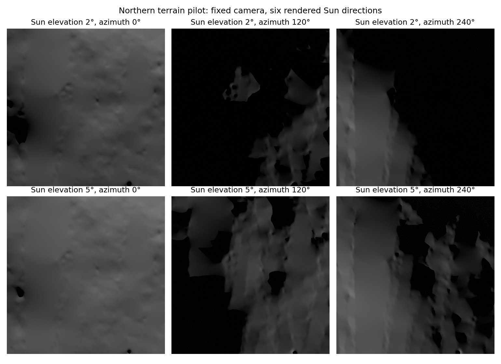

# Verified terrain pilots; training remains a negative result

All96northern pilot images completed in425.32seconds on the fixed two-thread
CPU. The corrected independent geometry audit recovers **12/12known camera
poses from exact correspondences**. This verifies an excluded data/software
pilot; it is not learned-matcher accuracy or a fresh final benchmark.

## What the controls establish

All four original pilot supports were acquired using100strictly verified
same-source encoded tiles (54,107,224bytes including the header). Source arrays,
curved meshes, body transforms, camera matrices and rendered files are hashed.
The reference-position/native-coordinate check has maximum0.000878pixel error;
independent source-mesh/ray checks have maximum0.0000435m error on the fixed
sample. Maximum oracle translation error is0.002705m, rotation0.0000233degrees.
These are numerical simulation controls, not physical lunar terrain accuracy.

The12geometry pairs come from four excluded terrain components and three query
views. Six repeated lighting configurations do not create72independent geometry
oracles. The linear44component render-cost projection is4,678.54seconds
(about78minutes), below the prospective six-hour cap; it remains an estimate.
No training, model-selection, calibration or final support was decoded by this
pilot. No matcher was evaluated on these pilots.

## Depth mistake, original failure and correction

The original v33audit failed because the pilot implementation incorrectly
called the raw Blender Z pass `ray_depth` and expected Euclidean range. The
prior analytic controls had already measured camera-axis depth. This was an
implementation mistake; the renderer convention did not change.

The original failed state, source,96images and geometry arrays remain preserved.
The corrected auditor binds its interpretation to the SHA of those earlier
independently audited analytic controls. It checks the raw pass against axial
Z, and separately computes Euclidean range from saved world positions. The
existing0.0005relative-depth tolerance,0.02pixel coordinate tolerance and
2degree/1%reference-range pose criteria remain fixed. The corrected pose
threshold uses the originally specified true median reference range. No
original pilot pose result existed: the first audit stopped before estimating
poses. The [recovery protocol](reports/north_depth_recovery_protocol_v34.json)
was recorded before the corrected oracle evaluation.

282repository tests/four optional skips and a fresh100row smoke pass, including
new off-axis depth controls that reject substituting cameraZfor ray distance.
[Complete pilot audit](reports/north_terrain_pilot_audit_v34.json).

## Historical exposure and remaining limits

The metadata-only audit of the named project image ledgers gives a conservative
39.31degree latitude gap after a1degree guard between prior pixel inputs and
all44candidate supports. All28,808known prior height-probe locations are outside
the supports with a1kmguard. The same audit replays byte-identically. This
supports geographic separation from the recorded project inputs; unknown
external-model pretraining overlap remains uncharacterized. The original
missing12fresh released-LunarGeo groups remain a separate failed requirement.
[Metadata exposure report](reports/north_historical_exposure_v34.json).

The shared source DEM, finite terrain halos, constant diffuse reflectance and
weak uniform background are simulation assumptions. Nominal10m source sampling
contains interpolated terrain and does not establish independently resolved
optical texture or subpixel regolith detail. This study cannot establish
verified orbital navigation accuracy or independent mission transfer.

## What this means for training

The completed three-seed6,000update cohort still selects initialization54/72;
trained endpoints47/47/49. Aggregation of all1,080saved checkpoint rows shows lower2pixel
correspondence precision at the endpoints:70.05%initialization versus62.07%,
61.40%,64.09%of scorable points. Correct correspondence counts fall as well.
This is consistent with degraded matching; it does not uniquely identify a
cause or prove a remedy. These reused four-component development results are
not fresh-generalization evidence. [Saved precision diagnosis](reports/mutual_precision_diagnostic_v34.json).

Next acquire/render only the immutable16training and8selection supports,
construct exact3D supervision, and measure an expanded-data architecture
control before another loss change. Leave4calibration and12final supports
unused until the fitting/case/threshold protocol is frozen. All six Sun settings
must enter training; the old three-light sampler must not silently truncate
them. Global negative construction must use body supports/component identities,
with local ENU poses kept explicit. Correctly labelled raw/axial/ray fields
must be mandatory in future rendered records.

The full model-improvement, calibrated acceptance/nonoverlap, author-profile,
transfer, uncertainty, paper and compact-v3requirements remain incomplete.
No paid compute, human review, automatic email or learned-upgrade claim.
