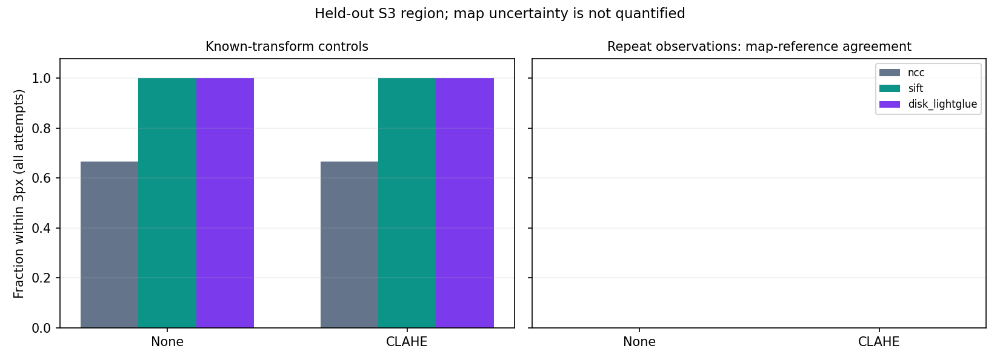

# Lunar image matching

A reproducible research project comparing classical and pretrained learned image matching on real lunar repeat observations and controlled image warps.

**Question:** How do matching methods behave when illumination changes on the same lunar terrain?

The project includes checksummed data acquisition, masked geospatial loading, NCC and SIFT baselines, pinned DISK + LightGlue inference, frozen region splits, quantitative evaluation, plots, an interactive offline viewer, a two-page PDF report, and an independent-checkpoint review tool.

**Scientific status:** repeat-observation measurements use the publisher's map coordinates. Their accuracy is unknown. These are map-reference diagnostics; independent checkpoint validation remains open. Exact-transform controls provide a separate correctness check. See [STATUS.md](STATUS.md) and [DATASET_CARD.md](DATASET_CARD.md). No NASA/JPL affiliation or endorsement is implied.

**Research extension:** [measured report](reports/EXTENSION_REPORT.md). The full 321-pair real-image experiment has executed (1,926 evaluations), alongside 1,152 physical-render evaluations on geographically separated Tycho patches. A small lunar descriptor adapter improved held-out synthetic registration from 93/128 to 98/128 pairs; its development-selected rejection policy still accepted three incorrect held-out alignments. Independent real reference review, common-grid CNSFM comparison and verified real-image transfer remain open.

## Install and run

Python **3.12** is the verified environment. From this repository:

```sh
python3.12 -m venv .venv
source .venv/bin/activate
pip install -r requirements-lock.txt
python reproduce.py --output runs/reproduction --test
```

The command downloads 15 source images (about 26 MB) and two pretrained weight files (about 52 MB), verifies their hashes, runs the test suite including actual pretrained inference, and evaluates all three regions. Original source rasters and weights are excluded from Git. CPU execution may take several minutes. Every run requires a fresh output directory.

For the small procedural software check:

```sh
python benchmark.py --config smoke.json --output runs/smoke-new
```

For individual stages:

```sh
python dataset.py fetch
python fetch_models.py
python evaluate.py --split test --output runs/held-out
```

Use `python reproduce.py --offline --output runs/offline` after assets and weights are cached. Missing or corrupt files produce explicit errors; learned matching never silently falls back to a classical method.

## Inspect results

The published pilot artifacts use the `lunar_` prefix: [report](lunar_REPORT.md), [PDF](lunar_REPORT.pdf), [per-pair measurements](lunar_results.csv), [summary](lunar_summary.json), and [environment/source hashes](lunar_environment.json).

Open `lunar_demo.html` locally for an interactive pair/method selector and overlay slider. GitHub displays HTML source, so download the file or serve this directory locally:

```sh
python -m http.server 8000 --bind 127.0.0.1
```

Then visit `http://127.0.0.1:8000/lunar_demo.html`. For a new run, open `runs/reproduction/demo.html` instead.



## Independent checkpoint review

The updated [source-bound review packet](reports/landmark_review.html) supports zoom, named landmarks, separate reference/query uncertainty and unscorable cases. Human review is required; it contains no suggested coordinates. Generate a fresh packet and import a completed review:

```sh
python landmark_review.py --output runs/manual-review.html
python import_review.py review.json --output reviewed_manifest.json
```

Add `--second-review review-b.json` when an independent second reviewer is available. Keep a second review blind to the first reviewer’s coordinates. The importer retains disagreement and raises the uncertainty estimate. Re-evaluate on the reviewed manifest; software validation alone does not establish human expertise or navigation accuracy.

The original simpler interface remains available:

```sh
python checkpoint_review.py --output runs/checkpoint_review.html
```

Open that page locally, identify at least ten distributed stable landmarks per pair, enter reviewer and picking uncertainty, and export `checkpoints.json`. Avoid using shadow edges. Import into a new manifest and rerun:

```sh
python apply_checkpoints.py checkpoints.json --output reviewed_manifest.json
python evaluate.py --manifest reviewed_manifest.json --output runs/reviewed
```

Imported annotations are recorded as independent reviewer input; the tool does not claim they are automatically verified. A second independent review and explicit uncertainty assessment are appropriate before navigation-accuracy claims.

## Data and methods

The subset uses five LROC NAC observations from each published CNSFM scene: Chang'e 3 (S1 reserved), Apollo 11 (S2 development), Peak Near Shackleton (S3 held-out). All source observations remain within one split. No training or parameter search is performed. Three exact-transform controls per region are evaluated separately from the twelve real repeat pairs.

- **NCC:** central template, translation-only; rotation is labeled out-of-model.
- **SIFT:** ratio-filtered features and partial-affine RANSAC, up to 2000 features.
- **DISK + LightGlue:** pretrained depth-supervised DISK features (512 maximum), learned matching and the same robust geometry estimator.
- **Ablation:** each method with and without CLAHE.

Transforms map reference `(x,y)` pixel centers to query `(x,y)`. Failures stay in denominators. Endpoint errors use valid evaluation points and independent targets when provided. Timings exclude downloads/model loading, use warmup, and synchronize the selected device. Different feature budgets and a single timing repeat limit speed comparisons.

The shared map grid is an external reference, not guaranteed subpixel truth. Gain/gamma perturbations do not reproduce moving lunar shadows. The original pilot uses no physical rendering or additional DEM, and no reproduction of LIMA is claimed. The extension uses externally rendered MoonAnything data as a separate experiment.

## Reproduce the research extension

The committed manifests are frozen before matching outcomes. Entire source scenes/acquisitions stay in one split. S3 was inspected in the pilot and is therefore exploratory for new choices.

```sh
python dataset.py fetch --manifest expanded_solar_manifest.json
python evaluate_extended.py --output runs/expanded-new
python fetch_moonanything.py
python moon_dataset.py --output moon_rebuilt_manifest.json
python train_lunar_adapter.py --manifest moon_rebuilt_manifest.json --output runs/adapter-new
python evaluate_moon.py --manifest moon_rebuilt_manifest.json --adapter runs/adapter-new/adapter.json --output runs/physical-new
python verify_extension.py --extended-run runs/expanded-new --physical-run runs/physical-new --output runs/extension-audit-new.json
```

MoonAnything acquisition downloads the metadata and physical Hapke render subarchives (about 0.9 GB), not the outer 11 GB ZIP. Byte-range retries and persistent hash-checked range caches support interrupted transfers. The real-appearance `render.zip` is an additional optional 4.7 GB download for expanding real repeat-observation regions. All downloaded archives, selected source rasters and caches remain outside Git. The report publishes measurement tables and a small trained descriptor projection.

The physical protocol uses 48 training, 16 development and 16 test patches from distinct acquisitions in separated Tycho longitude bands. Its 128px rendered supervision stays separate from real 512px map-reference measurements. All-zero physical renders remain explicit evaluation cases. The detector/backbone and LightGlue are frozen during descriptor adaptation. Threshold selection uses independently labelled development outcomes; provisional map disagreement is never a correctness label.

The original CNSFM Windows probe is verified in all three scenes. The [Windows workflow](.github/workflows/cnsfm-original.yml) supports a native probe, a common-grid probe, a full common-grid comparison, and an optional full native-resolution run. Common-grid inputs are verified byte-for-byte against the detector’s image/mask arrays, and forward/reverse matching are independent executions. Shared RANSAC scoring requires six inliers; that differs from the paper’s success definition. The original binary and model weights are retrieved separately from the pinned author repository.

To regenerate the optional crater predictions, install [requirements-detector.txt](requirements-detector.txt) in a separate environment and obtain the documented source revisions:

```sh
mkdir -p data/cnsfm
git clone https://github.com/Bin501/CNSFM.git data/cnsfm/upstream
git -C data/cnsfm/upstream checkout 94cebaaa7fd3e070f8040620975554c3067651ef
git clone https://github.com/WongKinYiu/yolov9.git data/cnsfm/yolov9
git -C data/cnsfm/yolov9 checkout 5b1ea9a8b3f0ffe4fe0e203ec6232d788bb3fcff
python cnsfm_detector.py --yolo-source data/cnsfm/yolov9 --weights data/cnsfm/upstream/CDAYOLOV9/YOLOv9Best.pt --output crater_predictions_new.json
```

The optional YOLOv9 integration retains GPL-3.0 terms. Its generated crater coordinates are method predictions and are never imported as independent reference landmarks. Native author patch tiling is not reproduced by the single whole-image common-grid detector pass; do not compare percentages directly with the paper.

## Repository guide

[AI_PLAN.md](AI_PLAN.md) defines the agent workflow; [MILESTONES.md](MILESTONES.md) preserves acceptance criteria; [STATUS.md](STATUS.md) distinguishes implementation from scientific validation. [THIRD_PARTY.md](THIRD_PARTY.md) records source/model notices. Code is MIT licensed; third-party data and weights retain their own terms.

References: [CNSFM paper](https://doi.org/10.3390/rs17132302), [source dataset](https://github.com/Bin501/CNSFM), [LightGlue](https://arxiv.org/abs/2306.13643), [DISK](https://arxiv.org/abs/2006.13566), [Adnan Ansar's public research](https://www-robotics.jpl.nasa.gov/who-we-are/people/adnan_ansar/).
