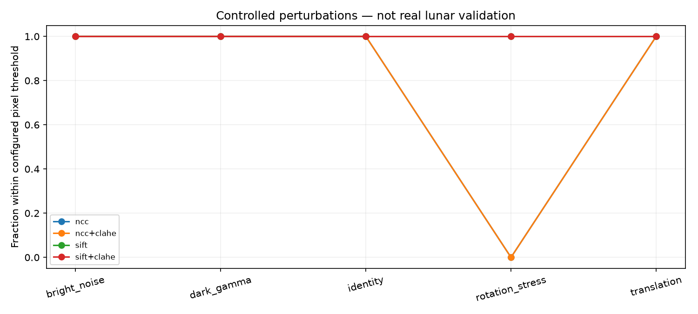
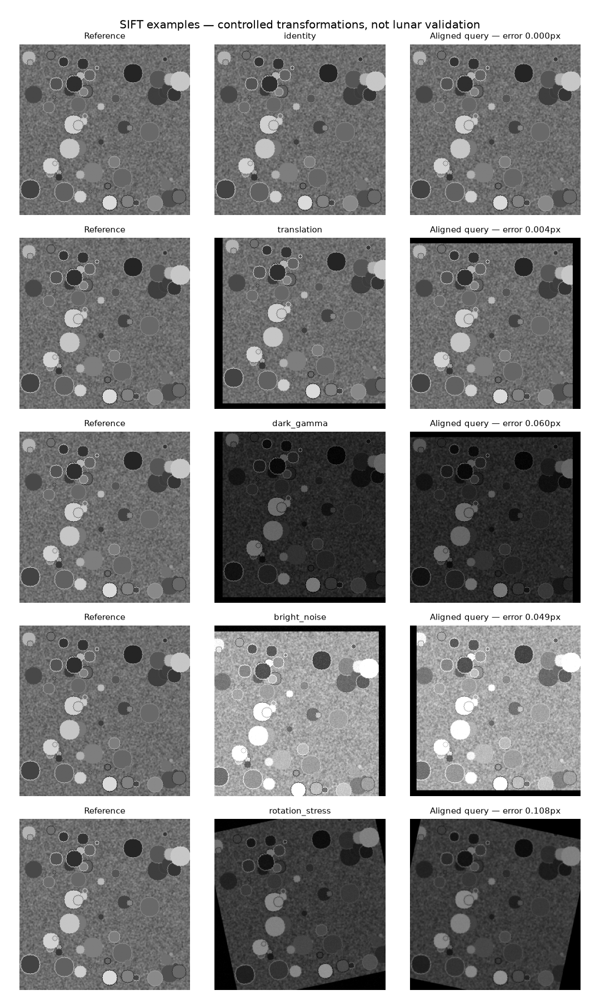

# Controlled smoke benchmark

This is a software validation experiment on procedural textures, not lunar imagery or scientific validation of illumination invariance. It does not implement LIMA or reproduce the lunar TRN paper.

## Protocol
Five seeds (42–46), 256x256 images, five conditions, four method/preprocessing combinations: **25 unique pairs and 100 evaluations**. Success means median endpoint error <=3 pixels on common-support grid points. No tuning or geographic split is claimed. SIFT uses partial-affine RANSAC; NCC is translation-only, so rotation is an explicitly out-of-model stress test. All registrations count in the success denominator; inability to estimate a transform is separately reported.

## Measured results

| Method | Case | Success | Median error, registered pairs (px) | Median CPU time (ms) |
|---|---|---:|---:|---:|
| ncc | bright_noise | 100% | 0.0000 | 1.72 |
| ncc | dark_gamma | 100% | 0.0000 | 2.15 |
| ncc | identity | 100% | 0.0000 | 2.01 |
| ncc | rotation_stress | 0% | 18.9017 | 1.82 |
| ncc | translation | 100% | 0.0000 | 1.52 |
| ncc+clahe | bright_noise | 100% | 0.0000 | 2.39 |
| ncc+clahe | dark_gamma | 100% | 0.0000 | 1.98 |
| ncc+clahe | identity | 100% | 0.0000 | 2.54 |
| ncc+clahe | rotation_stress | 0% | 18.9017 | 2.30 |
| ncc+clahe | translation | 100% | 0.0000 | 2.19 |
| sift | bright_noise | 100% | 0.0291 | 78.78 |
| sift | dark_gamma | 100% | 0.0289 | 49.31 |
| sift | identity | 100% | 0.0000 | 76.31 |
| sift | rotation_stress | 100% | 0.0805 | 56.93 |
| sift | translation | 100% | 0.0021 | 68.64 |
| sift+clahe | bright_noise | 100% | 0.0348 | 138.44 |
| sift+clahe | dark_gamma | 100% | 0.0163 | 128.03 |
| sift+clahe | identity | 100% | 0.0000 | 162.44 |
| sift+clahe | rotation_stress | 100% | 0.0654 | 189.72 |
| sift+clahe | translation | 100% | 0.0036 | 150.67 |

## Interpretation and limits
The translation-only matcher recovers the controlled translations and fails the rotation criterion. SIFT handles this modest controlled rotation. High success on these simple textures is not evidence of robustness to lunar shadows, relief, viewpoint change or real sensor noise. Five procedural seeds are not five lunar sites. Runtime includes CPU preprocessing and detector initialization and is machine-specific; it is not a rigorous cross-hardware speed comparison. CLAHE benefit cannot be established from this small smoke test.

## Verification
`python -m pytest -q`: **16 passed** (metric correctness, reproducible inputs, translation/rotation recovery, blank failures, denominator accounting and an end-to-end run).

`python benchmark.py --config smoke.json --output runs/verified`

The committed smoke_results.csv, smoke_summary.json and smoke_environment.json preserve measurements, environment and source-code hashes. The run was executed before a local Git checkout existed, so git_revision is null; the code hashes identify the executed files. Generated source data require no external download.

## Next experiment
M3: acquire and audit real lunar imagery and independent reference correspondences. Then complete M4 learned matching and M5 frozen real-region evaluation. No lunar performance or research novelty is claimed here.
