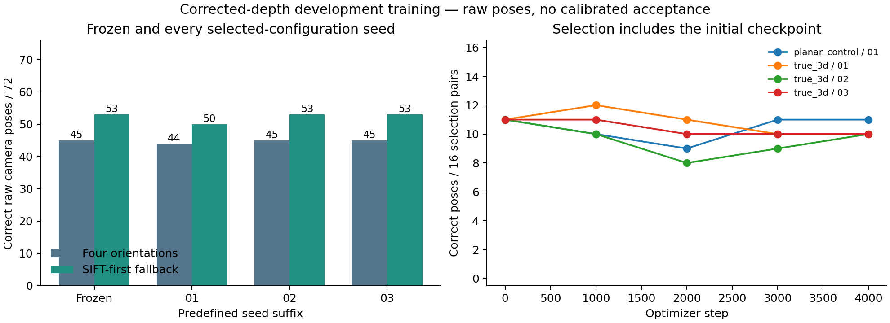

# Corrected axial-depth coarse-learning study

This study tests whether fine-tuning the compact coarse proposal encoder on true 3D pairs helps camera localization beyond the frozen four-orientation engineering baseline. Earlier ray-based results and training labels remain superseded by [the geometry correction](GEOMETRY_CORRECTION_V5.md). Only the corrected v5 data and geometry are used here.

## Completed experiment

All four runs finished 4,000 optimizer steps each (16,000 total): planar control and true-3D training at seed20261101, followed by the configuration selected on the fixed16-case bank at seeds20261102/03. Every run retains initial, selected, final and optimizer/RNG checkpoints, failed later checkpoints and executed source snapshots. The coarse network has28,272 trainable parameters, with a separate frozen28,272-parameter native encoder:56,544 combined.

| Training | Seed | Selected step | Correct raw poses | Stricter poses | Wrong raw poses | With SIFT fallback | Wrong fallback poses |
|---|---:|---:|---:|---:|---:|---:|---:|
| planar_control | 20261101 | 0 | 45/72 | 17/72 | 12 | 53/72 | 6 |
| true_3d | 20261101 | 1000 | 44/72 | 14/72 | 10 | 50/72 | 7 |
| true_3d | 20261102 | 0 | 45/72 | 17/72 | 12 | 53/72 | 6 |
| true_3d | 20261103 | 0 | 45/72 | 17/72 | 12 | 53/72 | 6 |

The frozen four-orientation baseline gives **45/72** correct raw poses. A stronger simple engineering control uses native SIFT whenever its pose estimator returns a pose, falling back to the frozen orientation bank otherwise: **53/72**, with **6 wrong poses**. The fallback uses no query truth or correctness labels for its decision, but was developed after looking at development evidence; it is not independent validation. Every learned candidate receives the identical fallback rule.

The primary selected candidate gives **44/72**, a change of **-1.39 percentage points** over the frozen orientation bank. Its descriptive component-bootstrap interval is [-6.35,+3.70] points. These intervals follow selection on only four exposed development components with unknown trajectory and shared renderer dependence. They are not an unbiased final-test estimate. All predefined seeds are reported; no best-seed headline is used.



The predefined primary seed by acquisition mode and lighting IDs:

| Mode | Lighting IDs | Pairs | Frozen correct | Trained correct |
|---|---|---:|---:|---:|
| dynamicgood | same | 12 | 4 | 6 |
| dynamicgood | different | 24 | 7 | 5 |
| nadir | same | 9 | 9 | 9 |
| nadir | different | 18 | 17 | 18 |
| oblique | same | 3 | 3 | 3 |
| oblique | different | 6 | 5 | 3 |

Lighting IDs do not provide a numerical Sun-angle separation. These subgroups are repeated views of the same development terrain, not additional independent samples.

## Interpretation and next hypothesis

Pose success, not descriptor loss, selects checkpoints. The initial checkpoint is eligible; selecting step0 is a failure to improve through training, not a new learned result. Longer fitting can reduce pose recovery even when a final batch has lower contrastive loss. Native refinement and orientation search predate this training, so their gain is not attributed to it.

The matched training ablations use uniform reference points with exact corrected axial-depth/camera targets. The planar control uses same-camera cross-light pairs with known warps; true3D uses other-camera images. Both use +/-90degree rotation,0.7–1.4scale,translation and identical sensor perturbations. Real rendered lighting variation remains separate from exposure/noise augmentation. Training samples components uniformly, then a tile and lighting pair. No matcher-selected correspondence is treated as truth.

A focused next hypothesis is that this very wide orientation training wastes the compact encoder's capacity when inference already tries four orientations. Test a geometry-canonicalized training orientation against the same uncanonicalized control, with unchanged architecture, learning rate, fixed inference, selection bank and step budget. Training-only query truth may build supervision and choose data transformations; it must never enter deployed inference or branch selection. This is a hypothesis, not an explanation established by the current experiment.

Corrected exact-correspondence controls recover26/26 development poses; rounding query correspondences to2/4/8/16/32pixel grids gives26/23/3/1/0 of26. One-pixel Gaussian noise still recovers26/26 even with30% random outliers in this fixed-seed control; two-pixel noise without outliers gives17/26. This demonstrates precision sensitivity under the controlled estimator and spatial sampling, not a universal noise guarantee. All468 detailed control outcomes are retained. The control was run after v5 training began and supplements, rather than replaces, the independent source/depth closure audit.

## Scope and verification

Training uses18 geometries/12 corrected spatial components. Model selection uses8 geometries/four other components,72 repeated lighting pairs and the fixed16-case bank. No calibration/test pixels were loaded. The original fresh-final data gate remains unmet. Correctness is rotation<=2degrees and translation<=1% actual median Euclidean reference range; stricter means0.5degree/0.1%. Missing and wrong poses stay in the denominator.

These are **raw estimates, not correctly accepted pose coverage**. The70% accepted-pose target, <=1% accepted-pose error/nonoverlap rate,10-point learned improvement over the strongest simple baseline, positive fresh paired interval and modern native-pose advantage remain unestablished. No SOTA, flight or verified orbital-navigation claim is made. Runtime here includes selection/evaluation and cache reuse, so is not an inference speed comparison.

Independent replay verifies completed optimizer budgets, actual trained weight changes, source/cache/weight hashes, all checkpoints and predefined seeds,10,297 uniform supported training points, native correspondence metrics, physical range, camera-to-world pose errors and all288 saved candidate cases. The previously saved correction inputs remain unchanged. The cohort training/selection timer records 45.72 minutes on two configured CPU threads (excluding initial cache loading/supervision preparation), below the48-hour training cap. No paid compute, human review or automatic outreach.

```bash
OPENBLAS_NUM_THREADS=1 OMP_NUM_THREADS=2 VECLIB_MAXIMUM_THREADS=2 python train_coarse_localization_v5.py --output runs/new-v5-coarse --steps 4000 --interval 1000
python verify_coarse_training_v5.py --run runs/new-v5-coarse --output runs/new-v5-coarse-audit.json
```

Report generation additionally needs the frozen correction capsule's baseline correspondences. Use new output paths; completed artifacts are immutable. Own code/weights are MIT; source renders derive from MoonAnything LunarGeo (Grethen et al., doi:10.5281/zenodo.18415119), CC BY4.0.
