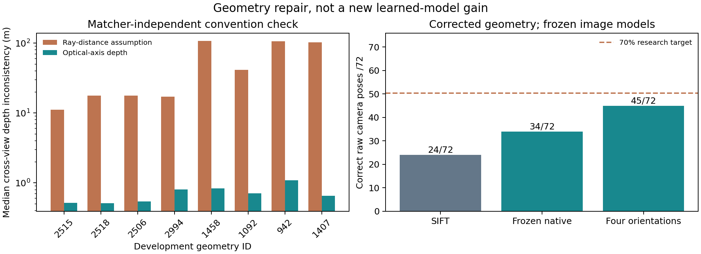

# LunarGeo geometry correction and continuing research

**Correction: the earlier LunarGeo 3D pose/correspondence results and 3D training labels used the wrong depth interpretation. They are superseded.** Preserve their frozen files for historical replay; do not present the old 3D numbers or oracle-window ceilings as valid dataset accuracy. This notice applies to the 3D sections of compact-v2, localization-diagnostics-v3 and compact-v3-development.

## Evidence and repair

The downloaded readme describes distance along a ray, and the original code followed that wording. A cross-view depth-closure test independent of the matcher and fitted pose found median disagreement of 11–107m on the eight selection geometries under that interpretation. Optical-axis z depth reduces it to about 0.5–1.1m. All 52 checked train/selection source EXR arrays equal the cached arrays exactly: this is not a cache conversion artifact.

The authors' [dataset loader](https://raw.githubusercontent.com/clementinegrethen/StereoLunar/ed6ea257475abb8a5235dff3a4d6167214b6f697/mast3r/dust3r/dust3r/datasets/LunarDataset.py) passes EXR depth into [DUSt3R axial unprojection](https://raw.githubusercontent.com/clementinegrethen/StereoLunar/ed6ea257475abb8a5235dff3a4d6167214b6f697/mast3r/dust3r/dust3r/utils/geometry.py). Both upstream files are pinned and hashed in lunargeo_depth_source_evidence_v5.json; upstream code was inspected, not copied or executed. The documentation/implementation conflict is explicit. The raw-file evidence supports axial depth for these audited files; future datasets still require their own convention check.

Convention selection used 18 original training geometries and no pose-performance score: the median of per-geometry depth residuals is 25.87 m for ray distance and 0.62 m for axial depth with stored intrinsics unchanged. A half-pixel principal-point shift produced only a small additional closure change; it is not adopted. We retain the published intrinsics exactly. The corrected module is lunar_geometry_v5.py; frozen legacy ray functions remain unchanged for replay.

The old exact-correspondence oracle could not catch this error because unprojection and projection shared the same mistaken convention. This is why independent source/data closure checks are required alongside a self-consistent pose control.

## Corrected measured outcomes

The same saved image coordinates and weights were rescored using axial reference geometry. The common estimator is AP3P/RANSAC, followed by LM and three rounds of reprojection-based inlier reclassification. The four-orientation baseline chooses by geometric inliers and residuals, without query depth/true pose. All 72 eligible positives stay in the denominator.

| Method | Correct raw pose | Stricter pose |
|---|---:|---:|
| Frozen coarse proposals | 6/72 | 0/72 |
| Frozen CNN + native refinement | 34/72 | 17/72 |
| Frozen CNN + four orientations | 45/72 | 17/72 |
| Native SIFT | 24/72 | 22/72 |
| Legacy-target reliability seed20261101 | 34/72 | 16/72 |
| Legacy-target reliability seed20261102 | 35/72 | 13/72 |
| Legacy-target reliability seed20261103 | 33/72 | 15/72 |

Primary correctness remains rotation<=2degrees and translation<=1% of actual median Euclidean reference range. Stricter means0.5degrees/0.1% range. Absolute pose errors and a replay of the former axial-depth-median normalization are saved. The frozen native baseline gives34/72 and the orientation bank45/72 under either normalization: their difference is not a relaxed threshold. Four-orientation inference adds no network parameters to the shared28,272-parameter frozen baseline. It is an engineering baseline, not newly learned novelty.

The legacy-target reliability checkpoints were trained before the convention repair. Their corrected33–35/72 results do not establish a useful learned contribution over the corrected stronger 45/72 baseline. The old headline 27/72,31/72,36/72 must not be reused as valid current 3D results. The 70% correctly-accepted-pose target,10-point gain over the strongest simple baseline, positive paired uncertainty interval, low accepted-error/nonoverlap rates and modern native-pose superiority are all **unestablished**.



These are eight previously exposed geometries/four selection components with repeated lighting, not72 independent terrain tests. No new final test or orbital-navigation accuracy is claimed. Pair-level acceptance is not calibrated; these are raw pose proposals, not correctly accepted-pose coverage. Runtime superiority is not measured by these cached, concurrently executed diagnostics.

## Data, training and remaining work

Corrected full-pixel footprints plus200m and repeated camera identities produce 16 spatial components across the existing 26 geometries:12 training components and four model-selection components, with no cross-split component. Unknown trajectory/batch and shared renderer dependence remain; the original fresh-data gate has not passed. No calibration/test pixels were loaded. Corrected labels are versioned separately in localization_training_data_v5.json; old manifests/caches remain unchanged.

The v4 coarse experiment was stopped after the convention issue was found; its partial/final checkpoints and source snapshots remain in runs/localization-v4-coarse-development. It is not a completed valid learning study. The corrected100-step v5 software pilot reproduced the45/72 starting baseline and retained initial weights; no pilot learning gain is claimed. A separate corrected4,000-step planar-versus-true3D cohort, with two additional predefined winner seeds, is now running under runs/localization-v5-coarse-development. Both inference pipelines use the same frozen native encoder/orientation bank. Combined model budget:56,544 parameters. Sources, labels and protocol are frozen before that cohort's fitting.

Continue the full research goal: establish a consistent learned gain, calibrate acceptance on a separate admissible split, run the required modern native-pose comparisons and untouched transfer, and produce the research paper/package only with defensible claims. Do not redefine success around the completed geometry correction. LuSNAR archive metadata is inventoried; scenes7–9 are reserved for future transfer, with actual case freeze/geometry audit still pending. Only development scene1 acquisition has started.

Earlier2D known-warp registration counts are separate, but their geographic-grouping assumptions also need a corrected-footprint audit before reuse. Historical reports/releases remain available with this correction notice; old 3D claims are not silently overwritten.

## Verification and commands

167 tests pass/four optional skips, including analytic axial-plane geometry, ray-vs-z discrimination, native rotation coordinates, and an actual frozen-model controlled quarter-turn pose. A fresh procedural smoke has100 rows/20 summaries. Independent replay verifies1,296 corrected records/15 aggregates, unchanged image coordinates, projection/visibility, physical range, pose errors and truth-free orientation selection. See localization_v5_rescore_audit.json. Data/source-depth and split audits are separate JSON files in reports/.

```bash
OPENCV_IO_ENABLE_OPENEXR=1 python audit_lunar_geometry_v5.py --output runs/replayed-source-geometry-audit.json
python prepare_axial_training_v5.py --output runs/replayed-axial-manifest.json --cache-root runs/replayed-axial-caches --audit runs/replayed-axial-split.json
python rescore_axial_geometry_v5.py --output runs/new-axial-rescore
python verify_axial_results_v5.py --run runs/new-axial-rescore --output runs/new-axial-audit.json
OPENBLAS_NUM_THREADS=1 OMP_NUM_THREADS=2 VECLIB_MAXIMUM_THREADS=2 python train_coarse_localization_v5.py --output runs/new-corrected-training --steps 4000 --interval 1000
```

Outputs are immutable; use new output/audit/cache paths when replaying. The raw-source audit requires the original LunarGeo archives. Saved-result replay uses the legacy model/data assets plus the corrected-development capsule. No paid compute, human review or automatic outreach is used. This work is independent and has no NASA/JPL affiliation.
