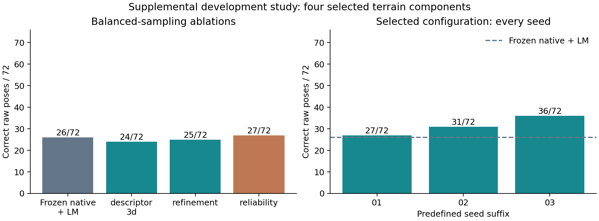
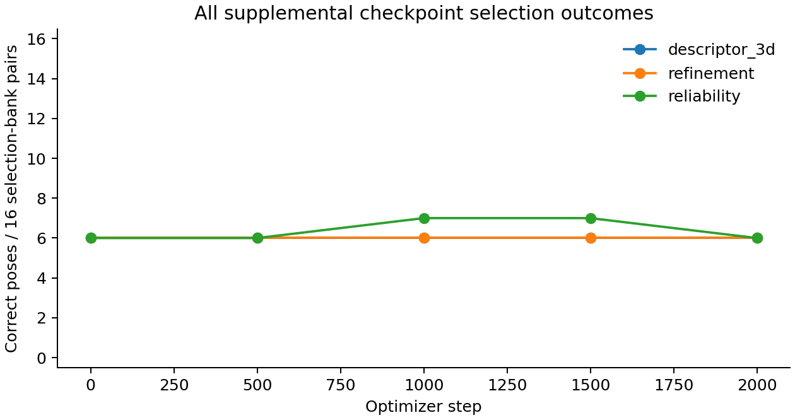

# Supplemental balanced-sampling study

This follow-up was chosen after the primary cohort exposed a low positive-label fraction and reliability overrejection. It is further tuning on the same development terrain, not preregistered independent confirmation. The [original five runs](LOCALIZATION_TRAINING_V3.md) remain unchanged: selected descriptor seeds 26/72, 25/72 and 26/72, against the deterministic native+LM baseline's 26/72.

Only the sampler changes: each batch has two geometrically valid local matches and two invalid proposals, rather than approximately 26% positives. Architecture, initialization, augmentation, 2,000-step/batch-four budget, physical lighting renders, pose estimator and 0.5 point-score cutoff remain the same. No calibration/test pixels are loaded. The random sample stream necessarily changes.

| Variant | Seed | Selected step | Full development poses | Last checkpoint bank poses | Positive labels / samples |
|---|---:|---:|---:|---:|---:|
| descriptor_3d | 20261101 | 500 | 24/72 | 6/16 | 4000/8000 |
| refinement | 20261101 | 500 | 25/72 | 6/16 | 4000/8000 |
| reliability | 20261101 | 1000 | 27/72 | 6/16 | 4000/8000 |
| reliability | 20261102 | 1000 | 31/72 | 6/16 | 4000/8000 |
| reliability | 20261103 | 2000 | 36/72 | 8/16 | 4000/8000 |

The configuration selected using the fixed 16-case bank is **reliability**. Its predefined primary seed recovers **27/72** raw poses, versus **26/72** for frozen native refinement + LM: **+1.39 percentage points**. All three selected-configuration seeds give **27/72, 31/72, 36/72**. There are 5 improved and 4 regressed pairs versus the baseline.

The primary candidate returns 17,260 points; 12,385 have co-visible geometric references. Among those scorable points, 57.64% are within 2 native pixels. It recovers 2/72 poses at the stricter 0.5-degree / 0.1%-range criterion. Co-visible point precision is conditional and must not hide invisible returned points or failed poses. Full 1/2/4/8/12-pixel counts for every seed are in localization_balanced_comparison_v3.json.

The post-selection descriptive component-bootstrap interval is [-11.11, +7.78] percentage points across only four development footprint components. Shared terrain/renderer and unknown trajectory dependence remain. A degenerate interval when case outcomes coincide does not imply equivalence elsewhere. No unbiased final-test interval, new SOTA result or reliable navigation claim follows from these data.

All five runs completed 2,000 steps, 18.78 wall-clock minutes including evaluation on two configured CPU threads. The two cohorts total 20,000 optimizer steps plus the separately retained 100-step pilot. Actual weight changes, failed checkpoints, initial/selected/final weights and executed source snapshots are retained. Model sizes including frozen coarse stay at 56,544 / 63,505 / 64,098 parameters.

These are raw pose results, not correctly accepted pose coverage: no calibrated pair-level acceptance policy exists. A 0.5 local matchability cutoff under balanced training is not a probability calibrated to the natural proposal prior. The default development command continues to return pose:null/transform:null/accepted:false, with raw correspondence proposals opt-in. Wrong-pose and nonoverlap acceptance targets, modern native-pose comparisons and fresh transfer evaluation remain unestablished.

Selection uses correct raw pose count on the same metadata-selected 16 pairs, then 2-pixel correspondence count and earliest step. Initial weights are eligible. All 72 pairs (8 geometries / 4 components, repeated lighting) are expanded development readouts. The primary seed is fixed; no best-of-seed headline is used. Success means rotation <=2 degrees and translation <=1% median reference range. Every eligible pair remains in the denominator.

Independent replay validates 234 geometric supervision cases, 360 candidate outcomes, source/weight hashes, complete optimizer budgets and selection/seed completeness for this cohort. See localization_balanced_audit_v3.json. Sources and measured artifacts are distributed with SHA256 checksums; [commands and scope](../LOCALIZATION_TRAINING.md) explain reproduction. The original fresh-data gate still governs any future generalization claim. No human review, paid compute or automatic outreach was used.

Local software verification: 147 repository tests passed and four optional tests skipped; fresh procedural smoke produced 100 rows / 20 summaries with exact saved-metric replay. The selected balanced primary model returns 358 procedural known-shift matches, with median error 0.353 native pixels and 260 within 2 pixels. Blank images and default rejection pass. This is a controlled software check, not independent lunar accuracy. The complete control record is localization_balanced_controls_v3.json.
