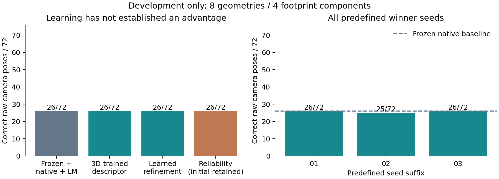
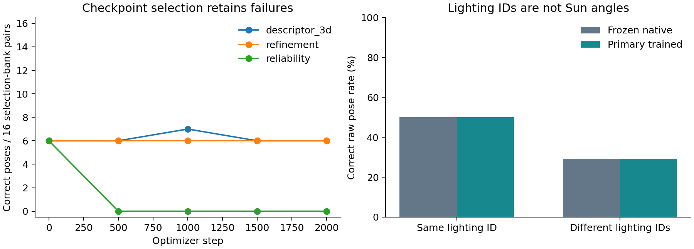

# Compact-v3 development training - iteration 8

The user requested training after the earlier fresh-data stop. This explicitly authorized development-only fitting on the original train groups. The historical data gate still governs fresh final validation. No calibration/test pixels were loaded and no old checkpoint/result was overwritten.

## Completed work and measured outcomes

Five runs completed 2,000 optimizer steps each: three ablations with seed 20261101, followed by the selected configuration with seeds20261102/20261103. Every run changed its final weights (independently replayed L2 norms), saved initial/selected/final checkpoints, retained failed selection outcomes and stayed below 100,000 total parameters including the frozen coarse network. A separately retained 100-step pilot preceded the common configuration.

| Candidate | Seed | Selected optimizer step | All development poses | Last-checkpoint selection poses | Total parameters |
|---|---:|---:|---:|---:|---:|
| descriptor_3d | 20261101 | 1000 | 26/72 | 6/16 | 56,544 |
| refinement | 20261101 | 500 | 26/72 | 6/16 | 63,505 |
| reliability | 20261101 | 0 | 26/72 | 0/16 | 64,098 |
| descriptor_3d | 20261102 | 1500 | 25/72 | 6/16 | 56,544 |
| descriptor_3d | 20261103 | 1000 | 26/72 | 6/16 | 56,544 |

The **unchanged frozen descriptor with deterministic native refinement and LM recovers 26/72** on identical cases. The primary trained candidate recovers **26/72**, a difference of **+0.00 percentage points**. The selected configuration's three outcomes are 26/72, 25/72, 26/72; their mean is 25.67/72. Training has not established a consistent pose advantage over the simple baseline.

The exploratory component-resampling interval is [+0.00, +0.00] points. The primary candidate succeeds on exactly the same 26 cases as the baseline, making this resampling interval degenerate. It does not establish precise equivalence outside these observed cases. It is descriptive, after model selection, on only four selected development footprint components with shared renderer/unknown trajectory dependence, not a fresh-test interval or proof of independence. The model-improvement/70%-pose research targets have not been established.

## What was learned

The full learned reliability head retained its initial checkpoint: later checkpoints recovered zero poses on the 16-case selection bank at the predeclared 0.5 point-score cutoff. This failure is visible in the table and curves. Its selected 26/72 result is the untrained-head fallback, not a successful newly learned rejection rule. The final trained weights are also distributed for diagnosis.

The prior engineering improvement remains important: native correspondence refinement and pose refitting recovered 26/72, compared with coarse+LM 3/72. That gain predates this training and is not attributed to the new network. The new descriptor-only training and pair-conditioned residual head did not improve the primary 72-case count under this budget.

For seed 20261101, 2,079/8,000 sampled examples had a co-visible correct correspondence inside the 33px search window. All-negative batches have no spatial loss in the descriptor-only/refinement ablations; reliability still has its binary loss. The fixed0.5 point cutoff and this class balance are plausible contributors to overrejection, not proven sole causes. Last-batch losses are not smooth training curves and are not used as evidence of convergence.

The subsequent [balanced-sampling cohort](LOCALIZATION_BALANCED_V3.md) tests positive/negative balancing without replacing these results. Further development should measure point-score calibration and ranking rather than assume 0.5 is useful, and inspect depth/visibility uncertainty before attempting finer coordinate supervision. Compare these changes against the frozen native+LM baseline and retain every predefined seed. A fresh independently characterized reserve is still needed for a method paper's generalization claim.

## Data, geometry and selection

Training uses eighteen geometries from eight original spatial components; model selection uses eight other geometries from four components. All lighting variants stay with their geometry; batch/trajectory independence remains unverified. The native cache contains 162 training and 72 selection stereo/light cases, with 52,613 coarse train proposals. Labels derive from source cameras/ray depth and the existing visibility convention (0.05 m + 1% relative range tolerance); these tolerances are not independent sensor uncertainty estimates. Query depth/true query pose never enter refiner or pose inference. Map-aided pose fitting uses reference depth/pose and query intrinsics.

The 16-case selection bank was chosen by metadata before training and covers all eight selection geometries. It selects checkpoints/configuration by correct unfiltered poses, then 2-original-pixel correspondence count, then earliest step. The initial checkpoint is eligible. All 72 cases are an expanded development readout; both sets were previously inspected and neither is a new test. The primary seed was predefined; no best-of-seed headline is used.

The criterion remains rotation error <=2 degrees and translation <=1% of median reference range. Missing/incorrect poses remain in the72-pair denominator. This is a simulated diagnostic, not a mission requirement. Local score filtering is not calibrated pair acceptance. No new false-acceptance, deployment risk, SOTA or verified orbital-navigation claim is supported.

## Software verification and distribution

145 repository tests passed/four optional tests skipped, including native-crop/whole-image feature agreement, subpixel mode selection, finite supervised/no-match gradients, split leakage prevention and checkpoint tamper rejection. A fresh procedural smoke produced 20 summaries. Actual trained-candidate known-shift/blank/default-rejection controls are in localization_training_controls_v3.json. Independent audit checks 234 supervised geometry/light cases, 360 saved candidate development outcomes, checkpoint/ablation selection, five completed training budgets and all winner seeds.

See [training and inference commands](../LOCALIZATION_TRAINING.md). Download separate own-model, supervised-data and experiment archives from the development release, with their SHA256 sidecars. Weights/source images are excluded from Git. Source data: MoonAnything LunarGeo, Grethen et al., doi:10.5281/zenodo.18415119, CC BY 4.0. Own model/code weights are MIT. No third-party pretrained weights, private correspondence, human annotation or paid compute is included.

No new calibrated pair-level policy is fitted. The development command returns transform:null, pose:null, accepted:false and empty correspondences by default. --include-proposals explicitly requests native-pixel research correspondences; --checkpoint final selects final rather than development-selected weights. The existing production matching command and previous frozen policies remain unchanged.

The cohort took 17.46 wall-clock minutes including selection/evaluation on two configured CPU threads, within the 48-hour training cap. This is experiment duration, not a matcher runtime comparison. Sources, caches, checkpoints and case lists are hashed; reproduction does not depend on matching-derived correctness labels.
