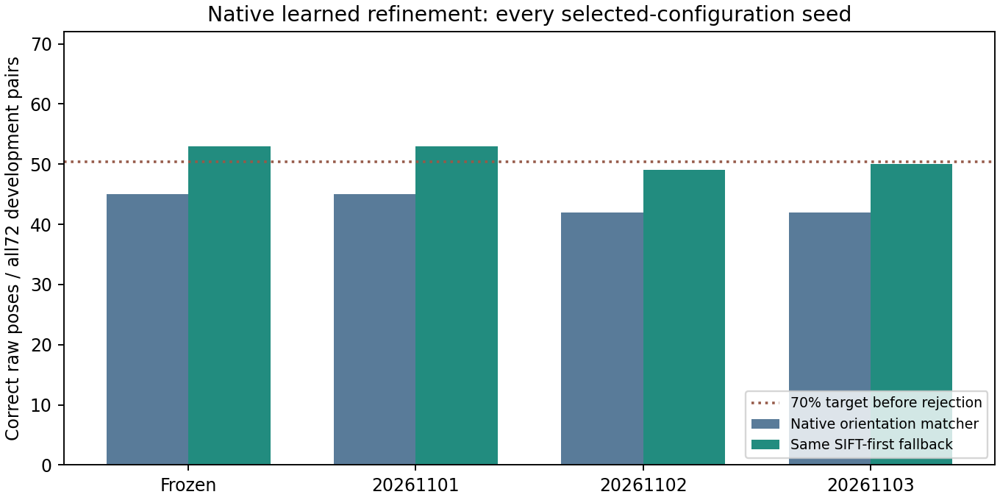

# Native refinement: completed development study

All three2000-step primary ablations and both predefined winner repeats completed:10000 optimizer steps. Each uses corrected axial-depth3D labels, a frozen coarse matcher, native512px image features and the same pose estimator. Selection uses the fixed16-case bank; all72 expanded readouts remain dependent, exposed development evidence from eight geometries/four terrain components.

| Variant | Seed | Selected step | Correct /72 | Strict /72 | Wrong raw poses | Correct with SIFT /72 | Wrong with SIFT |
|---|---:|---:|---:|---:|---:|---:|---:|
| encoder_3d | 20261101 | 1500 | 44 | 15 | 9 | 52 | 5 |
| pair_refinement | 20261101 | 1500 | 45 | 18 | 10 | 53 | 6 |
| dustbin | 20261101 | 0 | 45 | 17 | 12 | 53 | 6 |
| pair_refinement | 20261102 | 1000 | 42 | 14 | 13 | 49 | 11 |
| pair_refinement | 20261103 | 500 | 42 | 15 | 16 | 50 | 10 |

Frozen native orientation matching gives45/72, strict17, with12 wrong estimates. The stronger simple SIFT-first fallback gives53/72 with six wrong estimates. Every candidate receives exactly that same fallback decision: use SIFT when its estimator returns a pose, otherwise the candidate. This engineering rule was developed from exposed results; neither raw recovery nor fallback is calibrated acceptance. No query truth selects branches or fallback outputs.

The short100-step47/72 pilot is retained separately and is not the primary result. The learned dustbin ablation selects its initial checkpoint; trained versions reject essentially every point. Its failure remains published. Training loss and small correspondence-count gains do not establish a useful pose gain. All seed outcomes and descriptive component intervals are in native_training_comparison_v7.json. Those intervals use only four exposed components after selection, so they are not independent final-test confidence.

The uniform-positive coverage ablation is a separate subsequent experiment. Actual native LoMa-R and RoMa-v2 comparisons must finish all72 assigned cases and paired compact controls before any ranking. Their partial outputs are incomplete. The fresh final-data gate, reliable acceptance, transfer and paper targets remain unmet. Real orbital navigation accuracy is unverified. No human review, paid compute or automatic outreach.

Independent replay verifies360 candidate rows,234 cached supervision cases, source/weight hashes, actual optimizer completion and changes, balanced sampling/RNG, selection and every seed. Reproduce with `verify_native_training_v7.py` and this reporting command. Own code is MIT; source data are MoonAnything LunarGeo, Grethen et al., doi:10.5281/zenodo.18415119, CC BY4.0.
