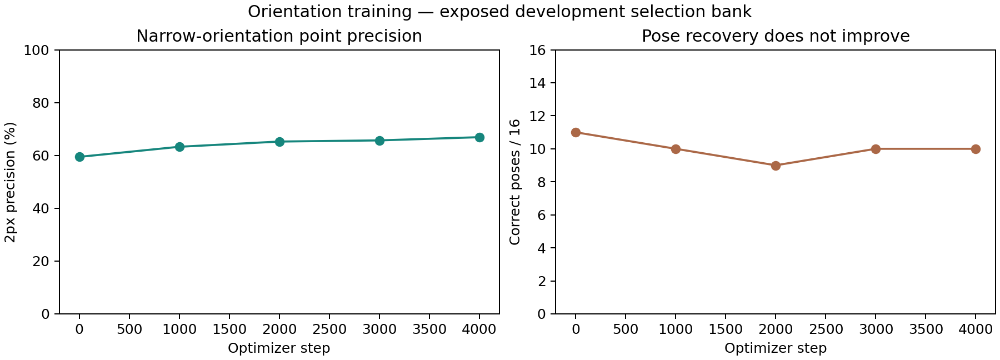

# Orientation training ablation: no pose improvement

All four4000-step runs completed (16000 optimizer steps). Training-only geometry canonicalizes the query to its nearest quarter-turn and adds small residual rotation; the control retains the preceding wide-rotation distribution. Model, optimizer, exact3D labels and four-orientation inference are unchanged. No query geometry enters inference.

| Training regime | Seed | Selected step | Correct raw poses | Stricter poses |
|---|---:|---:|---:|---:|
| true_3d | 20261101 | 1000 | 44/72 | 14/72 |
| canonical_3d | 20261101 | 0 | 45/72 | 17/72 |
| true_3d | 20261102 | 0 | 45/72 | 17/72 |
| true_3d | 20261103 | 0 | 45/72 | 17/72 |

The narrow regime retains initial weights and45/72. Its two-pixel point precision improves on the16-case bank during training, but pose recovery does not. The bank selects the wide control; all three wide seeds reproduce the v5 selected and final model tensors exactly. This is a reproducibility check, not three new independent confirmations or a learned gain. Every failed checkpoint remains preserved.

The stronger simple SIFT-first fallback remains53/72 with six wrong raw poses. Neither its coverage nor these raw pose counts establish the70% correctly accepted-pose target or1% error requirement. The four selection components/eight geometries produce72 dependent development pairs. No calibration/test pixels, fresh-final validation, modern ranking or verified orbital accuracy is claimed.

The native-resolution study now tests precision and a pair-conditioned no-match outcome. Its100-step pilot gives47/72 versus45/72 frozen, but that small development result is not a consistent gain. An independent corrected exact-in-window diagnostic gives67/72 with oracle projected correspondences; using all visible returned reference points gives72/72. These are query-truth controls, not methods or formal performance bounds. A separate training-source audit finds only3 and23 correct local coarse proposals in two difficult components; uniform projected positives are being tested separately. All work remains development research.

Independent replay validates288 outputs, optimizer completion, actual weight changes, source/cache/checkpoint hashes, selection and all predefined seeds. Own code/weights remain MIT; source data are MoonAnything LunarGeo (Grethen et al., doi:10.5281/zenodo.18415119), CC BY4.0. No human review, paid compute or automatic outreach. The original research goal remains unmet and active.
