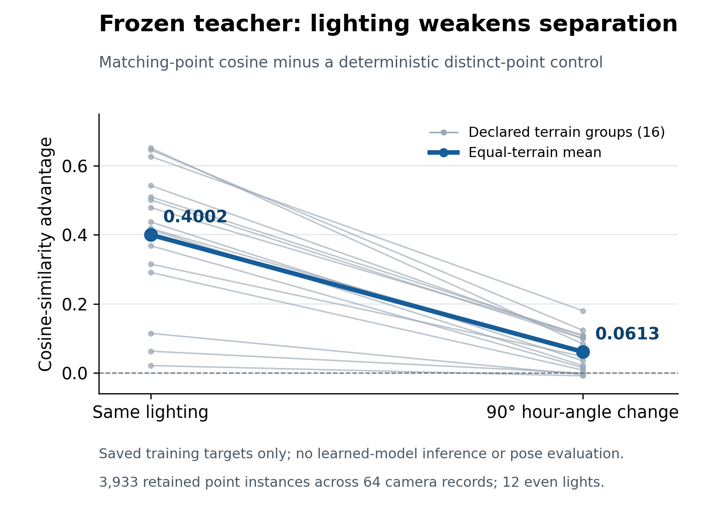

# Saved teacher features under changing lighting

This diagnostic describes the **original frozen teacher's saved training
targets**. It does not evaluate the trained response models, camera pose,
acceptance thresholds or generalization.

For each retained point instance, compare its reference descriptor with the
query descriptor at the same lighting and at a 90-degree hour-angle change.
The distinct-point control pairs saved point `i` with `(i + floor(n/2)) mod n`
inside the same camera record. Cosines use the saved unit-normalized 32D
features. Nothing is fitted and no image or neural model is run.

| Equal-terrain mean cosine | Same lighting | 90-degree hour-angle change |
| --- | ---: | ---: |
| Same point across views | 0.6680 | 0.3172 |
| Deterministic distinct-point control | 0.2679 | 0.2559 |
| Similarity advantage | 0.4002 | 0.0613 |



Each thin line represents one declared training terrain group. Average over
points and twelve even lighting configurations within each camera record,
then equally over four records per terrain and sixteen terrains. The plotted
mean is descriptive; the lines are not confidence intervals.

There are **3,933 retained point instances**, 64 camera records and 47,196
point-light comparisons. These are repeated observations, not that many
independent locations or terrains. The saved bank conditions on 163 explicit
trial-support omissions from 4,096 initially selected instances. No omission
uses brightness or a matching result.

The control pairs distinct world points, but it is not a mined hard-negative
set or a certified nonoverlap benchmark. Sixty of the 3,933 within-record
pairings are less than 33 reference pixels apart, so patch support can overlap.
Even-sized records also reuse reciprocal unordered pairs. The hour-angle
pairing contains six forward and six reverse pairs; the actual Sun-vector
angle is approximately 89.96074 degrees. No exact cyclic lighting model is
assumed.

The reduced separation motivates testing counterfactual descriptor responses.
It does not show that the new model has learned a useful response or improves
localization. That requires the separate frozen pose comparison and ablations.

The core arithmetic, applied only to the available even-light targets, is:

```python
a = teacher[:, 0, ::2]  # retained instances x 12 lights x 32 channels
b = teacher[:, 1, ::2]
j = (np.arange(12) + 6) % 12
other = (np.arange(len(b)) + len(b) // 2) % len(b)
same_margin = ((a * b).sum(-1) - (a * b[other]).sum(-1)).mean()
changed_margin = (
    (a * b[:, j]).sum(-1) - (a * b[other][:, j]).sum(-1)
).mean()
# Average these record means within each terrain, then equally across terrains.
```

The [summary and per-terrain values](solar_saved_teacher_signal_v81.json)
pin the original audit and rendering source hashes. The
[independent arithmetic replay](solar_saved_teacher_signal_replay_v81.json)
matches all reported values within 2.22e-16 and verifies availability,
normalization, physical distinctness and the stated limitations. The input is
the sealed [even-light teacher manifest](solar-learning-v79/teacher_full-bank.json).
