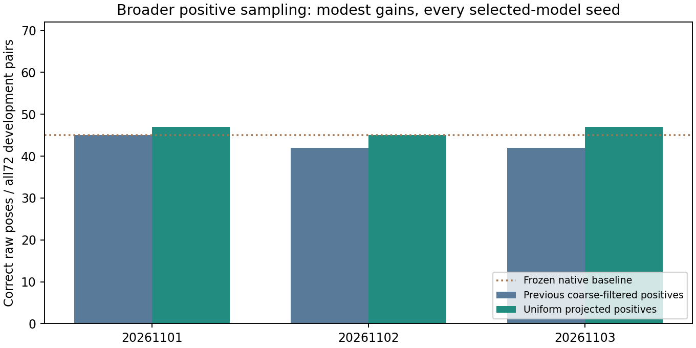

# Broader positive sampling helps modestly; the stronger control remains ahead

All five2000-step runs completed:10000 optimizer steps. The bank-selected pair-refinement seeds give **47/45/47** correct raw poses out of72, versus **45/42/42** with the previous positive sampler and **45** for the frozen native baseline. The encoder-only primary gives48/72 but is not substituted for the predefined selected configuration or primary seed. The failed no-match model again selects initialization after later checkpoints reject essentially everything.

| Variant | Seed | Selected step | Previous /72 | Uniform /72 | Strict /72 | Wrong raw poses |
|---|---:|---:|---:|---:|---:|---:|
| encoder_3d | 20261101 | 1500 | 44 | 48 | 16 | 7 |
| pair_refinement | 20261101 | 2000 | 45 | 47 | 15 | 10 |
| dustbin | 20261101 | 0 | 45 | 45 | 17 | 12 |
| pair_refinement | 20261102 | 1000 | 42 | 45 | 15 | 11 |
| pair_refinement | 20261103 | 1500 | 42 | 47 | 14 | 10 |

The change broadens positive location coverage across all12 training components and centers positive query patches around exact projections with jitter. Both coverage and centering change; this does not isolate one factor. Architecture, original negative sampler, optimizer/budget, sensor augmentations and native inference are unchanged. Real rendered lighting provides the physical appearance changes. Query geometry is training supervision/scoring only, never an inference input.

Gains over the previous trained configuration do not establish a large gain over the frozen model or the stronger deterministic surface control. That control gives54/72, or57/72 with the same SIFT-first fallback and two wrong outputs. Its inference pipeline differs and must be an explicit strong control for any future learned method. The uniform learned models retain many wrong poses and are not calibrated acceptance. All paired descriptive four-component intervals are in native_uniform_training_comparison_v8.json; repeated lighting pairs are dependent and this study cannot establish fresh generalization.

Independent replay validates all360 candidate results,234 cached supervision cases plus10463 uniform projected training locations, source/checkpoint hashes, initialization, actual weight/optimizer changes, exact sampler/RNG replay, checkpoint selection and all predefined seeds. Actual selected-model quarter-turn/blank controls pass for all five models. No calibration/test pixels, human review, paid compute, automatic outreach, SOTA or verified orbital accuracy claim. Own code/checkpoints MIT; MoonAnything LunarGeo data: Grethen et al., doi:10.5281/zenodo.18415119, CC BY4.0.

Replay with `verify_native_training_v8.py --run runs/localization-v8-uniform-native-development --output runs/new-uniform-audit.json`. The publication report preserves checked-in outputs. The next focused hypothesis is geometry-normalized supervision, assessed against the stronger deterministic pipeline, rather than adding another head to unnormalized features.
