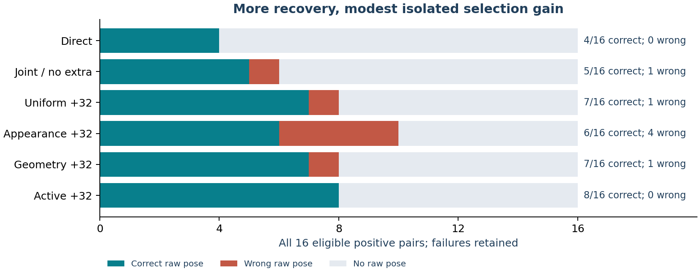
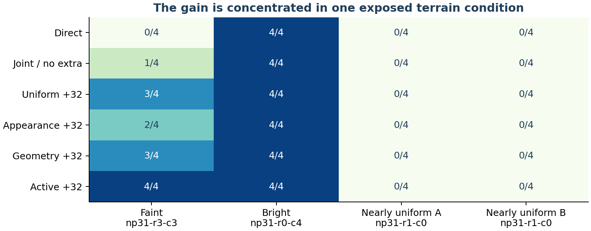
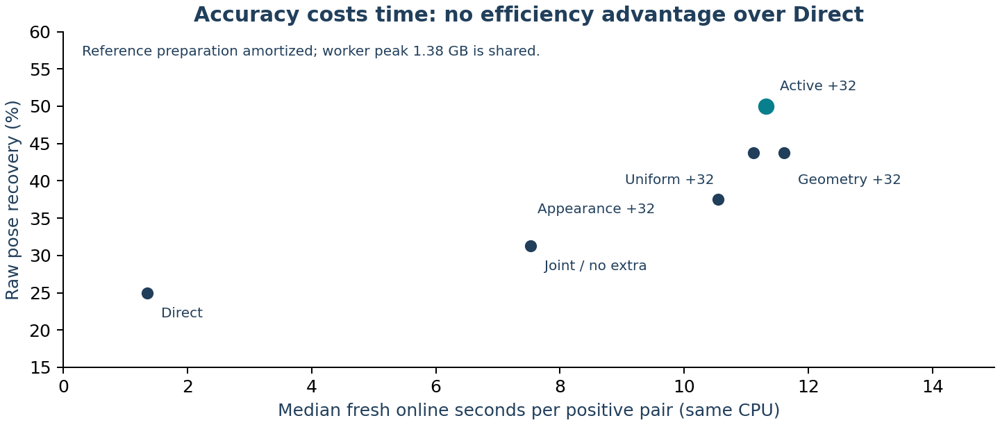

# Active acquisition: a positive development signal, not a qualifying model

The frozen active policy recovers **8/16 raw camera poses**, versus **4/16 Direct**,
**5/16 joint without extra measurements**, and **7/16 each for uniform and geometry
selection at the same 32-extra-patch budget**. Active returns no wrong positive
pose and no pose on 16 nonoverlaps. The prespecified preliminary signal passes.
No confidence threshold changed and no neural weights were trained.

The policy-specific gain is **one pose / 6.25 percentage points** over the strongest
equal-budget controls. Its descriptive terrain interval includes zero. The result
is a useful lead for technical feedback; the original research targets remain unmet.

## Complete matched comparison

| Method | Correct raw /16 | Strict /16 | Wrong positive | Raw nonoverlap /16 | 1px matches | 2px matches | Median online seconds, positives |
|---|---:|---:|---:|---:|---:|---:|---:|
| Direct, fresh exact control |4|4|0|0|1788|1817|1.357|
| Joint, no extra patches |5|4|1|0|89|95|7.524|
| Uniform +32 |7|4|1|0|228|244|11.113|
| Reference appearance +32 |6|4|4|0|229|240|10.549|
| Geometry +32 |7|5|1|0|217|235|11.602|
| **Active +32, primary** |**8**|4|**0**|**0**|224|243|**11.313**|

Correct: rotation <=2 degrees and absolute translation <=1% of median reference
range. Strict: <=0.5 degrees and <=0.1%. Every eligible positive, including
initialization failures, is retained. Match counts sum positive-pair native
correspondences, not independent terrain. Raw poses are not calibrated accepted
outputs. The public interface still withholds uncalibrated poses.

Fresh Direct endpoints, camera and estimator equal the historical frozen control
exactly. Fresh initialization also repeats its complete saved hypothesis list;
the saved camera is an identity check, never an input. All twenty cached controls
remain unchanged; their strongest result is 5/16. On eight available v135 rows,
the fresh no-extra result repeats the previous joint pilot exactly. All **832
method/case cells** pass both the original scorer replay and separate geometry
arithmetic that does not import the matcher, controller or pose estimator.

## What the result explains

The earlier 0/16 failure was caused by a chain of weak candidate support and
inadequate usable measurements; previous repairs alone restored 4/16, tying
Direct. The joint pilot improved a faint camera proposal but retained only five
reliable matches, below the original six-match AP3P gate. Extra acquisition now
brings all four faint noise pairings into reach for active selection. The solver,
appearance/reverse checks and three-native-pixel threshold remain unchanged.

| Faint rendering-noise pair (reference/query) | No-extra error, m | Uniform, m | Appearance, m | Geometry, m | Active, m |
|---|---:|---:|---:|---:|---:|
|0/0|no pose|23.75|20.09|14.80|**5.70**|
|0/1|no pose|8.37|12.37|**1.86**|11.08|
|1/0|27.19|17.17|25.89|15.80|17.35|
|1/1|14.17|14.10|17.43|22.25|**8.73**|

The faint translation limit is 18.79m; every returned pose here satisfies the
two-degree rotation limit. Uniform's 23.75m versus active's 5.70m on the first
pair is not a tiny threshold crossing. Nevertheless, active does not consistently
minimize translation error or maximize strict precision. Geometry has five strict
poses versus active's four. Uniform also has slightly more one/two-pixel matches.

All four bright noise pairings already succeed. **All eight nearly uniform
positives still fail** for active; their missing initializer is preserved, not
excluded. The four faint noise pairings reuse one terrain/camera/light condition.

The equal-budget controls share the same additional 3D template support, slots,
search limits, camera updates and final solver. Therefore, only active versus
uniform/appearance/geometry isolates the policy. Gains over no-extra also combine
additional measurements and an additional-template path; do not attribute the
whole improvement over Direct or no-extra to active selection.

## Scope, uncertainty and state of the art

This is **four exposed acquisition/lighting conditions on three terrain
components**, with two independent rendering-noise variants per image. It uses a
reference rendered at query-matching illumination. Historical case IDs preserve
their original light labels; those IDs do not make this a new changing-light
or estimated-Sun experiment. Query true pose, depth and Sun are scoring-only.
The current method adds zero parameters and is a classical acquisition/refinement
pipeline, not a newly trained compact neural model.

Enumerating 27 terrain-component bootstrap draws yields descriptive active-minus-
Direct interval **[0,78.33] pp**, and active-minus-uniform/geometry **[0,19.58] pp**.
All include zero. Three components are too few for stable population inference.
The negative analysis weights both endpoints; nine of 27 draws have no edges.
An all-zero negative bootstrap is not an upper risk bound. No 1% deployment
guarantee follows from 0/16 raw nonoverlap outputs or 0 wrong positives.

Active image search has substantial prior art, including
[Davison, ICCV 2005](https://www.doc.ic.ac.uk/~ajd/Publications/davison_iccv2005.pdf).
[PixLoc](https://openaccess.thecvf.com/content/CVPR2021/html/Sarlin_Back_to_the_Feature_Learning_Robust_Camera_Localization_From_Pixels_CVPR_2021_paper.html)
already learns features for geometric camera refinement. The present work tests a
specific native-correlation, weak-camera-direction and reference-height-envelope
proxy; this focused review does not establish novelty. Ansar's
[JPL profile](https://www-robotics.jpl.nasa.gov/who-we-are/people/adnan_ansar/)
lists relevant lunar TRN matching and localization work; we do not reproduce or
claim to beat his team's paper.

[LoMa](https://www.davnords.com/loma) and
[RoMa v2](https://arxiv.org/abs/2511.15706) report different standard benchmarks.
The separate historical native 48-positive/48-negative comparison remains Direct
30/48, LoMa-R 15/48 and RoMa v2 15/48 across eight development terrains.
The active method has not run that roster. **8/16 here cannot be ranked against
15/48 there or the papers' terrestrial benchmark scores.**
[Historical matched modern comparison](../SOLAR_FIVE_ARM_RESULTS_V123.md)

## Runtime and approved resources

Active is **8.33 times slower** than Direct on this CPU, with 11.31s versus 1.36s
median positive online time. Input decoding, fresh query features/initialization,
physical reference lookups and hypothesis management are included. Reference-only
projection/features may be cached; their misses and preparation are recorded.
The previously incurred physical rendering cost is not zero-cost online work.
Whole-worker peak RSS is 1,383,903,232 bytes, including shared reference caches;
it cannot rank method-specific memory. Two threads per serial scientific job,
OpenCV one, native512 and no paid compute are preserved.

The separately approved 2,400-second envelope reserves **120+1,800 seconds**.
Actual timing pilot/comparison elapsed is **66.43+499.38 =565.80 seconds**.
Successful jobs keep the fixed reservations: elapsed savings do not refund them.
The 480-second recovery envelope is unused and cannot silently become another
experiment. The full32-search generated flat/layered control passed before lunar
inference; its conservative forecast was 1,589.19s against the 1,800s cap.
Original cumulative accounting remains byte-identical: training 13,493s,
comparison 0s. Private journals, invocation identity and launch tickets are omitted.

## What is ready, and what remains

Ready: source-frozen development evidence, full replay, controlled ablations,
four figures plus a saved-output success/nonoverlap/failure demonstration, a
two-page brief and a six-page working draft. Local **1,490 tests pass, four
explicit skips**; fresh procedural image-to-pose smoke and independent replay pass.
See [reproduction](REPLAY.md), [method](METHOD.md) and the
[fourteen-requirement audit](../research_requirements_status_v137.json).

Still open: >=70% correctly accepted poses; >=10-point accepted gain with a
positive terrain interval; calibrated error/nonoverlap constraints; full A/B/C
and learned seed experiments; estimated query Sun; additional development terrain;
full terrain/occluder perturbations; sensor transfer; modern same-case accuracy or
efficiency; one-time frozen final evaluation. Four calibration and twelve final
terrain groups remain shut. Real orbital navigation accuracy remains unverified.

The work is suitable for an honest request for technical feedback, not a claim
of a breakthrough or a superior model. No email or paper is sent automatically.
