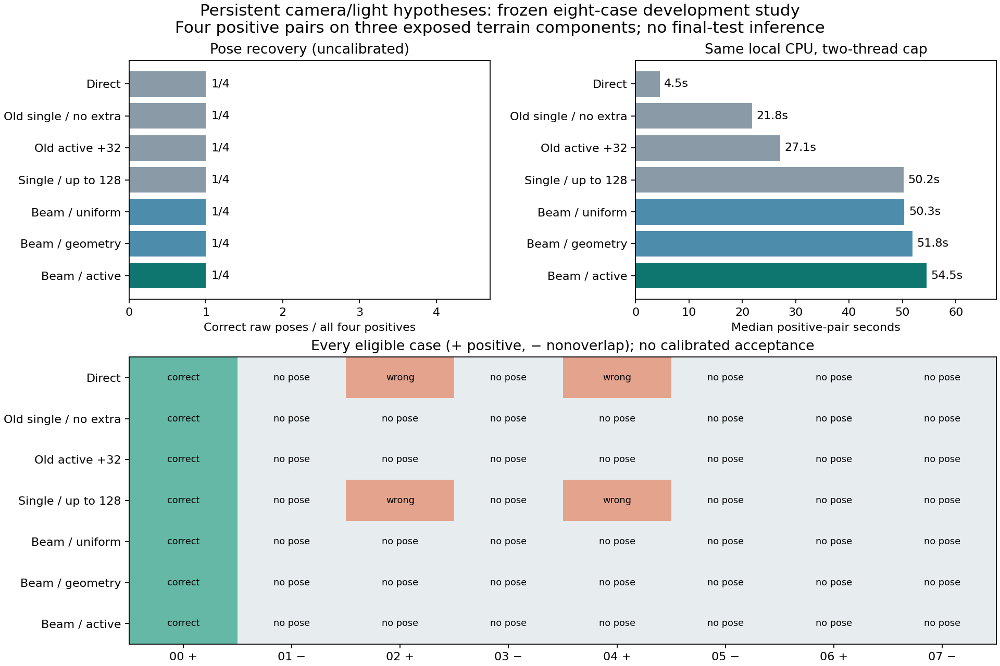

# Persistent hypotheses do not improve pose recovery on the frozen pilot

The complete seven-method, eight-case experiment finished on **7 November 2026**.
**Every method recovers the same one of four positive camera poses.** Keeping
multiple camera/lighting hypotheses through acquisition does not beat the strongest
matched control on this roster. Active beam selection also ties uniform and
geometry beam selection. The candidate is not promoted.

| Method | Correct raw /4 | Strict /4 | Wrong positive | Raw nonoverlap /4 | Native 1px / 2px matches | Median positive online seconds |
|---|---:|---:|---:|---:|---:|---:|
| Direct |1|1|2|0|449 / 457|4.53|
| Old single, no extra |1|1|0|0|18 / 18|21.77|
| Old active +32 |1|1|0|0|50 / 54|27.06|
| Strong single, common field cap |1|1|2|0|120 / 123|50.17|
| Beam, uniform |1|1|0|0|13 / 13|50.35|
| Beam, geometry |1|1|0|0|14 / 14|51.82|
| Beam, active |1|1|0|0|15 / 15|54.52|

Correct means rotation <=2 degrees and translation <=1% of median Euclidean
reference range. Strict means <=0.5 degrees and <=0.1%. All eligible positives,
including failures, remain in the denominator. These are **raw research poses**;
no method has calibrated acceptance in this experiment. The public experimental
interface continues to return `pose: null` unless raw research output is requested.
Correspondence totals are measurements, not independent terrain trials.



The beam methods avoid the two wrong positive poses returned by Direct and the
strong single control. However, the original no-extra and active+32 controls
already avoid those errors and recover the same correct pose. Active beam is
2.50 times slower than no-extra, 2.01 times slower than old active+32, and 12.04
times slower than Direct on positive-pair median times. There is no measured
recovery or efficiency advantage over the strongest matched compact control.

## What was implemented and tested

The frozen [implementation](../solar-beam-v143/README.md) searches the unchanged
24-light reference catalogue and up to 2,048 camera proposals. It selects up to
four lights and eight spatially diverse camera/light seeds, then retains every
qualified branch throughout native patch acquisition and camera updates. All
eight branches qualify on every case in this experiment.

Each new policy receives **128 actual branch-specific field attempts per case**.
The single control spends its full allowance on one camera; each beam policy
spends 16 anchors across eight branches. They share the same reference candidate
universe and spatial scheduling rules. Failed support is charged. No free initial
query-correlation bank is added to these new controls. Branch weights retain an
exploration floor and never prune an alternative. Each branch keeps one global
catalogue lighting choice, and the final result comes from one complete branch.

The final estimator is unchanged: reciprocal native measurements, at least six
matches, AP3P/RANSAC, and a three-native-pixel reprojection threshold. Neither
confidence calibration nor this threshold was changed. The three historical
controls reproduce their earlier endpoints, poses and estimator decisions exactly
in all **24 method/case identities**. New controls test branch retention and patch
policy at a common field allowance; a gain over an older smaller budget alone
would not establish either contribution.

All images are native 512-pixel, dither-free RGB16 lunar renders decoded to linear
luminance. Inference receives reference imagery/geometry/pose, intrinsics and the
reference lighting catalogue. Query depth, true camera and true Sun are scoring
inputs only, opened after the complete eight-case prediction seal. This is
discrete catalogue illumination selection, with **zero new trainable parameters**.
It does not complete the planned learned lighting-response model or establish
continuous Sun inference, certified solar visibility or orbital navigation accuracy.

## Why recovery did not improve

Post hoc diagnosis uses only already saved hypotheses and scoring truth. It does
not rerun inference, add candidates or tune policy.

| Case | Condition | True catalogue light retained? | Any accurate initial camera? | Any accurate final active-beam branch? | Selected active 2px matches |
|---|---|---|---|---|---:|
|00|bright|yes|yes|yes|13|
|02|nearly uniform A|yes|no|no|1|
|04|nearly uniform B|yes|no|no|1|
|06|faint|yes, rank four|no|no|0|

The earlier initializer discarded the faint case's correct light. The new one
keeps it, but its closest saved camera is still **364.51m** from truth with
**12.11-degree** rotation error. Preserving that alternative does not recover
geometry. None of the three failed positives has an accurate saved initial
camera, an accurate camera along the beam's saved update trajectory, or a correct
final AP3P branch under any of the three beam policies. There is no hidden correct
final branch for a different winner-selection rule to recover on these cases.

The new single control returns inaccurate poses on both nearly uniform cases:
**17.42m versus a 13.13m limit**, and **31.29m versus a 15.88m limit**. Its 123 total
correspondences within two pixels across the positive roster do not guarantee
accurate absolute pose. Low texture, coordinate precision, spatial distribution
and geometric conditioning need to be studied together. The beam also splits a
limited field allowance across branches, so a failed beam outcome alone does not
prove that candidate coverage is the only cause.

The strong single control's saved optimization trajectory visits an accurate
soft camera on both nearly uniform cases, although its final AP3P poses are
wrong. Those oracle-scored intermediate states are not measured output successes.
They identify a second issue to investigate: precision and conditioning at the
handoff from correlation-field camera fitting to discrete matches and final pose
estimation. Substituting a truth-selected intermediate camera would invalidate
this comparison.

The next algorithmic work should target camera-proposal coverage, informative
geometry and the measurement-to-pose handoff, with separate tests of each. A
useful follow-up would compare a coverage-preserving hierarchical camera/lighting
search and adaptive branch-specific measurement allocation against this frozen
beam at equal cost, then test correspondence uncertainty in the common estimator.
Measure proposal recall and native search reach as diagnostics, then select by
actual unfiltered pose recovery. This is a proposed investigation, not a measured
improvement or a novelty claim. More beam width alone is not supported by this run.

## Uncertainty and claim limits

There are **four positive pairs on three exposed terrain components**, with two
conditions sharing one component; four negative pairs involve six terrain
endpoints. These are reused development cases, not fresh test geography. All
27 paired terrain-component bootstrap draws give a zero recovery difference.
That empirical interval does not establish population equivalence. Negative
endpoint resampling enumerates 46,656 draws, with 5,070 undefined no-edge draws.
Its all-zero interval does not establish a 1% deployment-risk bound.

No modern pretrained model was run on this clean roster. The historical
default-dither modern experiment and papers reporting match precision,
relative-pose AUC or reconstruction quality cannot rank this candidate. The
dated [primary-source review](../solar-review-v141/literature.json) remains
background. The original >=70% correctly accepted poses, >=10-point matched gain,
positive paired interval, error constraints, modern tradeoff and transfer targets
remain unmet. Calibration and final terrain stay untouched.

## Reproducible execution

The source/data freeze was published before inference at commit
`dbeb77776b330518c7d5a1c02ccf98e02ccd2bdb`:
[protocol](../solar-beam-v143/protocol.json), **115 source pins, 134 input pins and
109 inference-only paths**. The v143 implementation README is the historical
pre-experiment record; this report supplies its measured outcome.

Both full generated cost controls pass all seven pose checks on flat/layered
geometry, with 24 lights, 2,048 cameras and the complete field allowance. They take
94.64/103.21 seconds, yielding the frozen 1,283.52-second comparison forecast.
These generated pattern controls test software and geometry, not physical sunlight.

The approved **1,800-second** cap covers generation controls, prediction, scoring
and independent replay. Whole controller elapsed is **1,238.06 seconds**; prediction
worker elapsed is 1,006.36 seconds. The full cap remains charged under the published
rules. All previous original/supplementary charges are preserved. Two CPU threads
per serial scientific job, OpenCV one, no paid compute, no training, and no access
to calibration/final terrain were used. Peak inference-worker RSS is
1,050,288,128 bytes including imports and shared caches; it is not per-method memory.

Per-method latency includes decoding and the shared reference/branch preparation
assigned to that method plus its policy, native searches and final geometry.
The single-hypothesis control deliberately pays common beam preparation for this
causal comparison. These times do not characterize a separately optimized
single-only implementation. Policies rotate order across cases; old and new
wall times must not be compared across different runs as an algorithm speedup.

All **56 method/case cells** independently replay, including Sun error, native
correspondence precision, pose errors, retained branch identities and actual field
charges. Public replay additionally reconstructs terrain intervals and the saved
branch diagnosis. [Software verification](software-verification.json) records the
repository checks and fresh generated controls.

Download the [result capsule](https://github.com/ThomasdeChillaz/lunar-image-matching/releases/tag/solar-beam-v144-development)
and its checksum, both existing
[clean-input parts](https://github.com/ThomasdeChillaz/lunar-image-matching/releases/tag/solar-blind-v139-cost-gate),
and the previous
[v142 result capsule](https://github.com/ThomasdeChillaz/lunar-image-matching/releases/tag/solar-blind-v142-development).
Verify checksums and extract all four archives into one checkout, then run:

```sh
python reports/solar-beam-v144/replay_saved.py
```

This uses saved outputs and public files. It runs no matcher, fits no policy and
requires no private launch authority. The capsule excludes current private
approval and execution records; its completion receipt is sanitized.

[Machine-readable results](results.json) · [Saved-branch diagnosis](branch-diagnosis.json) ·
[Completion receipt](completion-receipt.json) · [Public replay](independent-replay.json) ·
[Capsule checksum/inventory](capsule.json) · [Original requirements](../research_requirements_status_v144.json).
The broader research goal remains unfinished. No email or paper is submitted.
