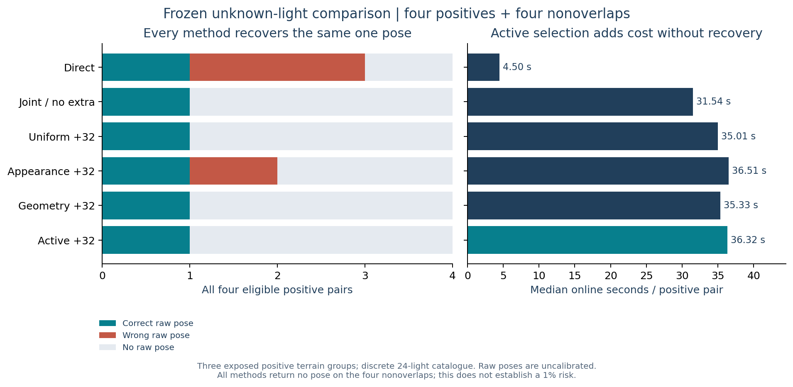

# Unknown-light comparison: no active-selection recovery advantage

The complete frozen six-method, eight-case experiment finished on 6 November
2026. **Every method recovers the same one of four positive camera poses.** Active
selection ties Direct, joint without extras, uniform and geometry. Its extra
patch searches do not improve recovery on this roster. No candidate is promoted.

| Method | Correct raw /4 | Strict /4 | Wrong positive | Raw nonoverlap /4 | Native 1px / 2px matches | Median positive online seconds |
|---|---:|---:|---:|---:|---:|---:|
| Direct |1|1|2|0|449 / 457|4.50|
| Joint, no extra |1|1|0|0|18 / 18|31.54|
| Uniform +32 |1|1|0|0|49 / 50|35.01|
| Appearance +32 |1|1|1|0|51 / 56|36.51|
| Geometry +32 |1|1|0|0|44 / 45|35.33|
| Active +32 |1|1|0|0|50 / 54|36.32|

Correct means rotation <=2 degrees and translation <=1% of median reference
range; strict means <=0.5 degrees and <=0.1%. All four eligible positives remain
in the denominator. Correspondence totals are measurements, not independent
terrain tests. Raw outputs are research hypotheses, not calibrated acceptances.



Active avoids Direct's two wrong positives, but no-extra, uniform and geometry
also do so. It is 8.07 times slower than Direct and 1.15 times slower than
no-extra on positive-pair medians. This does not demonstrate an active-policy
accuracy or efficiency benefit. Appearance's additional wrong pose also shows
that more apparently precise correspondences need not yield an accurate camera.

## What the experiment actually tests

Native 512-pixel, dither-free RGB16 images are decoded to linear luminance.
Every method searches the same 24-image reference lighting catalogue. The joint
initializer considers up to 2,048 camera proposals, retains two lighting choices
and refines eight camera/light seeds before the fixed native patch methods.
No query-matching reference image, query true pose, depth or Sun is supplied to
inference. Query truth is used only after all eight predictions are sealed.

This is **discrete catalogue lighting selection**, with no certified solar-ray
support or continuous Sun estimate. It adds zero trainable parameters. It is not
the completed learned A/B/C model. Camera estimation still uses the original
AP3P/RANSAC and three-native-pixel threshold; no confidence or threshold changed.

Four positives and four nonoverlaps cover **three exposed positive terrain
components**, with one component reused by two positive acquisition conditions.
Negative analysis records both endpoints across six components. The old v137
8/16 supplied-light result uses a different input/replicate setup; it is preserved
and cannot be treated as a matched before/after accuracy comparison.

## Saved-output failure diagnosis

The post hoc analysis scores the eight already saved photometric camera
hypotheses per positive. It performs no new matching or candidate search.

| Case | Condition | Correct light rank by minimum coarse loss | Retained coarse lights | Any correct saved camera hypothesis? | Active 2px matches | Active result |
|---|---|---:|---|---|---:|---|
|00|bright|1|0, 1|yes|46|correct, 0.65m|
|02|nearly uniform A|1|0, 1|no|3|no pose|
|04|nearly uniform B|2|0, 1|no|5|no pose|
|06|faint|4|15, 23|no|0|no pose|

All queried illuminations are present in the catalogue. On the faint case the
correct light is lost before native acquisition. On both nearly uniform failures
it survives, but none of the eight retained cameras meets the original pose
criterion. More lighting alternatives alone therefore do not explain every
failure. The observations motivate a future test of maintaining distinct
camera/light alternatives through acquisition; they do not prove that change
would recover a pose.

On case04, appearance selection returns seven correspondences within two pixels,
yet its pose has 57.73m translation error against a 15.88m limit. Active retains
only five matches, below the unchanged six-match estimator gate. Precision,
spatial conditioning and hypothesis support remain relevant; loosening the gate
or confidence threshold is not supported by this study.

## Uncertainty and comparison limits

All methods have identical per-case correct-pose indicators. Active-minus-control
gain is zero; all 27 three-component bootstrap draws also give zero. This
describes this small sample and **does not establish population equivalence**.
The endpoint-weighted negative bootstrap enumerates 46,656 draws; 5,070 contain no
edges and remain undefined. Its all-zero empirical interval is not a bound on
deployment risk. Four nonoverlaps cannot establish the original 1% risk target.

No modern pretrained model was run on this new clean roster. Historical
default-dither Direct/LoMa/RoMa results and published terrestrial, relative-pose
or dense-reconstruction scores cannot rank this candidate. See the dated
[primary-source review](../solar-review-v141/literature.json). The original
>=70% accepted-pose and >=10-point gain requirements remain unmet.

## Execution and replay

Source/data freeze: public commit `39fda97c4f0f9170c01efe91cad566d8229b2f63`;
[protocol](../solar-blind-v140/protocol.json), 104 source hashes and 130 input
hashes. Both complete generated controls pass, taking 46.23 and 50.21 seconds.
The new conservative comparison forecast is 632.52 seconds and fits the remaining
approved cap. All 48 method/case cells independently replay.

The user explicitly approved one new 900-second cap. Whole controller elapsed is
471.60 seconds, including generated controls, inference, scoring and replay.
The full cap stays charged, with no refund or additional run. Peak inference
worker RSS is 945,954,816 bytes including shared caches; it cannot rank individual
methods' memory. Two CPU threads per serial job, OpenCV one, no paid compute,
unchanged original accounting and untouched calibration/final terrain are retained.
The prior failed v139 attempt is preserved.

The replay package contains raw research predictions, seals, scores, timings,
independent arithmetic and sanitized completion metadata. It excludes current
private ledgers, launch tickets and correspondence. Extract both existing
[clean-input capsule parts](https://github.com/ThomasdeChillaz/lunar-image-matching/releases/tag/solar-blind-v139-cost-gate)
and the new result capsule into a checkout, then run:

```sh
python reports/solar-blind-v142/replay_saved.py
```

This reconstructs saved geometry metrics and component analysis without running
a matcher or requiring private execution authority. It does not reproduce fresh
inference or grant compute permission. [Machine-readable results](results.json),
[post hoc diagnosis](proposal-diagnosis.json), [completion receipt](completion-receipt.json)
and [all original requirements](../research_requirements_status_v142.json) preserve
the evidence and remaining work. No email or paper is submitted automatically.
