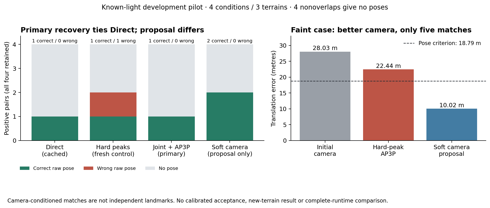

# Shared-camera correlation fitting: a useful lead, no primary pose gain

The new method preserves ambiguous native image correlations until one shared
camera explains them. **The final matcher recovers 1/4 poses, tying Direct and
failing the preregistered improvement rule.** It removes the hard-peak control's
one wrong positive pose. No candidate is promoted and no acceptance threshold
is changed.

The camera-fitting stage supplies a narrower positive signal: it reduces the
faint case's translation error from **28.03m to 10.02m**, within that case's
18.79m criterion. Its separate raw camera proposals recover 2/4 positives.
However, only **five reliable image matches** survive on the faint case. The
unchanged final AP3P pipeline requires at least six, so it returns no pose.
The camera proposal is not the primary result or independent image validation.

## Frozen matched comparison

| Method | Correct raw poses /4 | Strict /4 | Wrong positive poses | Raw nonoverlap poses /4 | Matches within 1px | Matches within 2px |
|---|---:|---:|---:|---:|---:|---:|
| Direct, exact saved control |1|1|0|0|445|453|
| Fresh native hard peaks |1|1|1|0|22|25|
| **Joint camera + image-grid modes + AP3P, primary** |**1**|**1**|**0**|**0**|**23**|**23**|
| Cached initial camera, proposal only |1|1|2|2|0|0|
| Soft joint camera, proposal only |2|1|0|0|0|0|

Correct means rotation <=2 degrees and translation <=1% of median Euclidean
reference range. Strict means <=0.5 degrees and <=0.1%. All four positives,
including two nearly uniform conditions, remain in the denominator. Raw poses
are not calibrated acceptances. The two proposal-only rows have no image
correspondence outputs and are not interchangeable with the primary matcher.

All **24 methods x 8 image pairs = 192 cells** independently replay. The twenty
cached controls are unchanged. The fresh hard-peak control exactly reproduces
v134's coordinates, camera and estimator on every case. All cached completed
matching controls recover at most 1/4 here. The primary's descriptive paired
terrain interval is [0,0] on this tied sample; it does not establish population
equivalence. Three terrain components cannot establish a 1% risk. Endpoint
resampling has nine of 27 draws without a negative edge, explicitly retained in
the report. [Complete table and uncertainty](results.json)

## What changed, and what still fails

For the same 36 reference anchors, keep the supported 49x49 masked native
correlation fields. Fit a single six-dimensional camera to their robust,
smoothed correlation potentials. Then obtain actual image-grid posterior
modes, perform local fractional peak fitting and apply the original appearance,
ambiguity and independent reverse checks. Finish with the unchanged three-pixel
AP3P/refit. This adds no trainable parameters. [Algorithm and prior art](METHOD.md)

On the faint case, the hard control returns eight matches: four within one pixel
and seven within two, but its camera is 22.44m wrong. Joint conditioning retains
five, all within one pixel. Six candidates fail the independent round-trip check,
20 fail the appearance check, one is ambiguous and one lacks reference support.
These checks remain frozen; relaxing them after seeing the scores would be
another experiment. On the bright case, all 18 returned matches remain within
one pixel and final camera error falls from 1.00m to 0.41m. The two nearly uniform
conditions still fail. [Saved-only failure diagnostic](saved-diagnostic.json)

The next concrete hypothesis is **additional image acquisition after soft camera
fitting**: select new, supported anchors that distinguish surviving camera
hypotheses, then acquire their native patches. It must be compared with equal
numbers of uniform and appearance-ranked additional searches. The direct camera
fit also needs equal-initializer, hard-correspondence camera-refinement controls.
Neither test has run. Do not lower the six-match requirement, return camera
projections as measured landmarks or present the proposal-only count as the
primary gain.

## Scope and relation to the earlier zero-pose failure

The preceding shared-camera repair changed the complete historical diagnostic
from 0/16 to 4/16 poses. Its native variants did not beat Direct. That unchanged
16-positive result remains in [v134](../solar-local-v134/RESULTS.md).
This is a smaller, predetermined follow-up: **four exposed camera/lighting
conditions on three terrain components**, one fixed noise pairing each, and
four certified nonoverlaps. It uses matching illumination and a camera already
predicted from the same images in sealed v134 outputs. No true query camera,
depth or Sun is an inference input. Conditional correspondences are not
independent landmarks. There is no new-geography, unknown-Sun, learned-response,
transfer, orbital or final-test result. Four calibration and twelve final terrain
groups remain closed.

The separate larger matched development benchmark remains Direct 30/48,
LoMa-R 15/48 and RoMa v2 15/48. The new method has not run that roster. Neither
this four-positive sample nor a literature table establishes state-of-the-art
performance. [Historical modern comparison](../SOLAR_FIVE_ARM_RESULTS_V123.md)

## Verification, timing and original resource envelope

Source and cases were published at commit
`66c515a160ff11ad1d06e2d969d22423a1cba790` before inference. The charged generated
pilot passes flat and layered image-to-camera controls and forecasts 59.98s for
the eight-case study, below its 80s cap. The study, sealing, scoring and independent
replay finish in 21.73s. **Both fixed charges, 15s and 80s, remain charged.**
The original baseline/comparison allowance is exhausted; 13,493 training seconds
remain. This is conservative reservation accounting, not a claim that every
reserved second was consumed. Further inference needs a prospective supplementary
resource decision, without changing the original ledger or targets.

Only the new stage is freshly timed: its median positive time is 1.84s, after
loading the cached initializer. Historical control timings are not rerun. No
complete-inference speed advantage is claimed.

The full local suite passes **1,470 tests / four explicit skips**. Public CI at
the scientific source freeze passes **1,466 / eight skips** and its end-to-end
smoke. Seven focused new tests include ambiguous competing peaks, generated
camera controls, exact hard-peak repetition, unknown support and blank inputs.
A fresh procedural benchmark and its matching CSV-schema verifier also pass.
The historical JSON-artifact verifier cannot read that CSV schema; its invocation
failure is recorded separately and does not alter results. All 49 protected
learning and 42 physical source hashes remain unchanged.
[Verification](software-verification.json) · [Replay instructions](REPLAY.md)

All fourteen original research requirements remain in force. The >=70% correctly
accepted target, >=10-point accepted gain with a positive terrain interval,
<=1% empirical error constraints, complete A/B/C evidence and final/transfer tests
remain unmet. [Current requirements audit](../research_requirements_status_v135.json)
