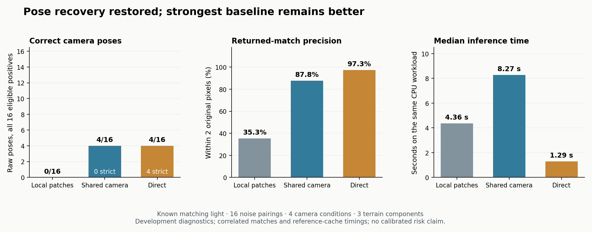

# Zero-recovery failure fixed; strongest baseline remains better

The shared-camera pipeline recovers **4/16 raw camera poses**, improving
on the previous local-patch controls' **0/16**. Direct also
recovers **4/16**, with better precision and lower runtime. The predefined
improvement rule fails. No superior model or final-test result is claimed.

All **224 method/case cells** complete in **345.29 seconds**. Independent
saved-score replay passes, and the original five methods reproduce their
saved correspondences, poses and estimator evidence exactly.

| Method | Correct poses /16 | Strict poses /16 | Native matches within 2 pixels | Raw nonoverlap poses /16 | Median positive time |
|---|---:|---:|---:|---:|---:|
| Original measurement | 0 | 0 | 0 | 0 | 3.83 s |
| Boundary halo | 0 | 0 | 0 | 0 | 3.90 s |
| Pooled uniform | 0 | 0 | 6 | 0 | 4.49 s |
| Pooled parallax | 0 | 0 | 6 | 0 | 4.36 s |
| Shared camera + uniform | **4** | 0 | **43** | 0 | 8.26 s |
| Shared camera + parallax | **4** | 0 | **43** | 0 | 8.27 s |
| Full Direct reference library | **4** | **4** | **1,817** | 0 | **1.29 s** |



Correct means rotation ≤2° and translation ≤1% of median reference range.
Strict means ≤0.5° and ≤0.1%. The shared-camera variant is approximately
**6.4× slower** than Direct on this CPU workload. It supplies 49 retained
matches, of which 43 meet the two-pixel criterion; these counts are pooled
over all 16 positives, not independent accuracy trials.

The complete seven-arm job peaked at approximately 1.34 GB resident memory,
including shared reference caches. This is not a per-method memory ranking.

## Why the zero result happened, and what changed

The original local measurement rejected every patch. Pooled scores and
valid-support corrections restore a few measurements but no pose. The
new module fits one physical camera to multiscale image evidence at about
1,600 fixed reference 3D points. That shared constraint improves the next
native search enough to recover all four bright render pairings. Final
poses still use actual reciprocal image measurements and the unchanged
AP3P solver; optimized projections are not substituted for observations.

No method recovers a final pose on the faint condition or either
near-uniform condition. Parallax selection adds no measured pose benefit.
The paired difference against Direct is zero on every positive pairing;
this small tied result does not establish population equivalence. The raw
gain over the repaired local-patch control is 25 points, concentrated in one
camera condition, and does not establish the required accepted-pose gain
or a positive terrain-level uncertainty interval.

## A useful diagnostic, with a substantial failure

Post-hoc scoring of the already saved, top-ranked photometric camera
proposals gives **5/16 correct** and **4/16 strict** before native verification.
The same proposals include **7 wrong positive poses** and poses on **8/16
nonoverlaps**. They cannot be treated as verified localization outputs.

On the representative bright pairing, the photometric proposal is about
0.90 metres from truth. Its subsequent measured-match pose misses the
stricter threshold. This identifies a precision loss in the native handoff,
alongside the faint case's unresolved measurement shortage. The diagnostic
does not change the principal four-pose result, thresholds or model.
[Proposal-only audit](proposal-diagnostics.json) · [Replay code](score_proposals.py)

## Scope and next requirement

These four exposed camera conditions reuse **three terrain components**;
the 16 pairings vary independent rendering noise. Eight pairings are
near-uniform stress cases. All methods receive supplied matching
illumination, and Direct receives all 24 reference renders plus the same
matched-light reference. This is separate from the historical 48-positive
modern benchmark. Real orbital navigation accuracy remains unverified.

The next accuracy work must improve faint-region correspondence recovery
and preserve subpixel camera precision under changing light. It then needs
a broader matched study with estimated Sun direction. Confidence fitting
cannot supply the missing image evidence. The new control has no additional
learned weights; no learned checkpoint is promoted. Calibration and final
terrain remain reserved because no candidate beats the strongest control.

## Reproduce the saved results

After extracting the development replay bundle into the tagged checkout:

```sh
python reports/solar-local-v131/replay_saved.py
python reports/solar-local-v131/score_proposals.py
```

[Exact principal summary](results.json) · [Frozen protocol](protocol.json) ·
[Method](METHOD.md) · [Preceding repair](../solar-local-v130/RESULTS.md)
