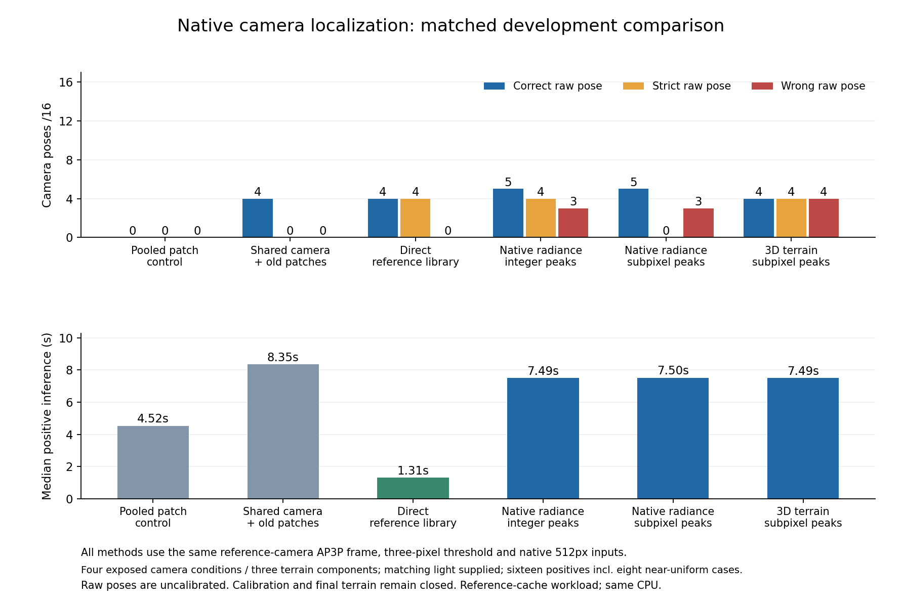

# Zero-pose failure repaired; the new techniques do not beat Direct

The original local-patch failure is repaired: shared-camera initialization
recovers **4/16 raw poses** rather than 0/16. Three additional native-radiance
variants are now implemented, tested and independently replayed. **None passes
the frozen improvement rule.** The primary 3D variant ties Direct's 4/16 correct
poses but adds four wrong positive poses and runs about 5.7 times slower.
No new model, calibrated result or final-test gain is promoted.

All **640 method/case cells** complete in **391.05 seconds**. The seven historical
controls reproduce their saved coordinates, poses and estimator evidence exactly.
Every coordinate-frame control preserves all measured image endpoints.

| Method, common reference-camera AP3P frame | Correct /16 | Strict /16 | Wrong positive poses | Raw nonoverlap poses /16 | Matches within 2px | Median positive time |
|---|---:|---:|---:|---:|---:|---:|
| Pooled patch control |0|0|0|0|6|4.52s|
| Shared camera + old patches |4|0|0|0|43|8.35s|
| **Direct reference library** |**4**|**4**|**0**|**0**|**1,817**|**1.31s**|
| Native radiance, planar integer peaks |5|4|3|0|94|7.49s|
| Native radiance, planar subpixel peaks |5|0|3|0|97|7.50s|
| **Primary: native radiance, 3D subpixel peaks** |**4**|**4**|**4**|**0**|**98**|**7.49s**|

Correct means rotation ≤2° and translation ≤1% of median reference range. Strict
means ≤0.5° and ≤0.1%. Wrong positive poses are raw proposals on overlapping pairs,
not calibrated acceptances. Every failure remains in the 16-pair denominator.
The complete twenty-method table and per-condition counts are in
[results.json](results.json). The whole job peaks at about 1.37 GB resident memory,
including shared caches; this is not a per-method memory ranking.

## What the controlled changes show

- **Native radiance and denser measurement recover more image matches.** The
  primary arm retains 112 matches, 98 within two pixels, versus 49/43 for the old
  shared-camera handoff. Radiance handling, filtering and anchor count change
  together in that historical comparison; the gain cannot be assigned to one.
- **Subpixel fitting alone does not help pose precision.** Under the same 36-anchor
  planar setup, raw recovery stays 5/16 and strict recovery falls from 4 to 0.
- **Full 3D patch warping restores bright-case precision but loses the extra faint
  success.** It gives 4 strict poses rather than 0 for planar subpixel, while raw
  correct recovery falls from 5 to 4 and wrong outputs increase from 3 to 4.
- **Reference-frame AP3P fixes the generated flat-scene failure, with no lunar
  recovery gain here.** Original and reference-frame variants have identical
  correct/strict/wrong counts. The frozen solver and three-pixel threshold stay.

The primary has zero paired raw gain over framed Direct: the same four pairs
succeed. The planar variants gain one faint noise pairing, **6.25 points**, while
adding three wrong poses. Their descriptive terrain-group intervals include zero.
A zero paired interval on this tiny tied primary sample does not establish
population equivalence. [Paired analysis](paired-results.json)

## Why the remaining poses fail

All four bright noise pairings supply 18 primary matches within one pixel and
camera errors of roughly 0.97–1.02 metres. On the faint condition, the primary
retains 8–10 matches, only 2–5 within one pixel; its translation errors are
**22.44–81.84m**, above the unchanged 18.79 m correct-pose limit. The two near-uniform
conditions still return no pose and stay in the denominator.

A post-hoc projection-Jacobian audit gives hypothetical position RMS sensitivity
of 18.55–46.42 m for independent one-pixel measurement noise on the faint cases.
The bright condition gives 14.46 m for that same hypothetical noise, while its
actual image measurements are much more precise. Some faint match hulls cover
more image area than the bright hull, so greater spatial spread alone is not
established as the solution. This is local sensitivity at saved cameras, not
calibrated uncertainty or a causal proof. It generates no new pose.
[Diagnostic and assumptions](conditioning-diagnostic.json)

The next substantive technique should retain local correlation ambiguity and
fit the shared camera to those image likelihoods, rather than immediately turning
each broad peak into one endpoint. It needs an equal-budget hard-peak control,
actual pixel-precision and raw-pose gains, plus nonoverlap tests. This remains a
research proposal; no benefit or novelty is established by the present results.
Acceptance-threshold tuning cannot supply the missing image precision.

## Scope, modern comparisons and remaining requirements

These are four exposed camera/lighting conditions on **three terrain components**,
with repeated independent rendering noise and supplied matching illumination.
They are not sixteen independent terrains, an unknown-Sun test or orbital
navigation validation. Every new image arm has the same 36-anchor budget. Direct
receives all 24 reference renders plus the same matched-light reference.

The separate, larger 48-positive development benchmark remains unchanged: Direct
30/48, LoMa-R 15/48, RoMa v2 15/48. The new methods have not run that full roster;
the 16-pair diagnostic cannot establish their ranking against those models or
published papers. [Historical matched modern comparison](../SOLAR_FIVE_ARM_RESULTS_V123.md)

The ≥70% correctly accepted-pose target, ≥10-point accepted gain with a positive
terrain interval, ≤1% accepted-error/nonoverlap constraints, learned contributions,
estimated-Sun study and transfer/final evaluation remain unmet. No confidence
model is fitted here. Four calibration and twelve final terrain groups stay shut.
The remaining original envelopes are 13,493 training seconds and 95 baseline
seconds. Further large scientific comparisons require a prospective resource
decision; prior failures are not refunded.

## Verification and preserved failures

The failed v132 generated gate, v133 invalid JSON output, original deadlines and
charges remain intact. V134 only represents an unavailable margin on an already
rejected measurement as `null`; it changes no matching decision. The repeated
study was source-published before inference and sealed before scoring.

Public CI passes 1,457 tests/eight optional skips and its end-to-end smoke.
Sixteen focused current geometry/matching/serialization checks pass, as do a fresh
eight-toggle procedural run and independent replay. All 49 learning and 42 physical
source bindings remain unchanged. Saved-metric replay verifies all 640 cells;
additional sensitivity checks test physical units and degenerate geometry.
These software checks do not establish model quality.

[Protocol](protocol.json) · [Method and admission](METHOD.md) ·
[Verification scopes](software-verification.json) · [Reproduction](REPLAY.md)
