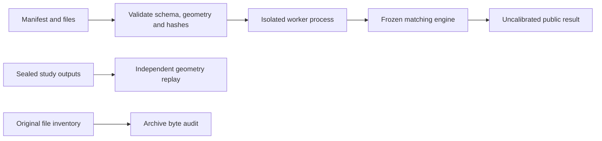

# Architecture and coordinate contracts

The maintained package exposes a small interface around a frozen research engine.
The engine is preserved because published source hashes and metric replay depend
on its exact bytes. This is an explicit compatibility boundary; it is not a claim
that every historical experiment has been rewritten or optimized.



| Module | Responsibility |
|---|---|
| `cli.py` | Stable commands and clear errors; no model import for help/status |
| `validation.py` | Reference-only input contract, exact file hashes, native RGB16, calibrated cameras |
| `artifacts.py` | Streaming SHA-256, byte preservation and exclusive complete JSON writes |
| `evidence.py` | Validate recorded case counts and present the actual measured result |
| `backend.py` | Launch one isolated worker with a two-thread cap |
| `_worker.py` | Load historical imports only inside the child process |
| `compat.py` | Preserve original command names and caller-relative output paths |
| `paths.py` | Explicit repository and historical workspace locations |

## Images and geometry

Native images are 512x512 RGB16 PNGs. The frozen decoder converts sRGB to linear
luminance. A validated RGB8 image is still not an equivalent input to this experiment.
Masks express available reference geometry; darkness is not a visibility label.

Correspondences map **reference pixel centres to query pixel centres** in native
coordinates. Intrinsics are calibrated 3x3 pixel matrices. Poses are rigid 4x4
**camera-to-world** transforms, with right-handed rotations. Depth stores axial
camera Z. For reference pixel `(x,y)` and axial depth `z`:

```text
p_reference = z * inverse(K_reference) * [x, y, 1]
p_world     = R_reference * p_reference + t_reference
p_query     = transpose(R_query) * (p_world - t_query)
```

Projection divides by query camera Z. The pose metric's translation normalization
uses the median Euclidean range to reference surface points. Query true pose,
depth, Sun and scoring labels are forbidden as inference inputs.

## Persistent hypotheses

The engine searches a 24-light catalogue and up to 2,048 camera proposals. Up to
four lights and eight qualified camera/light branches survive acquisition. Each
branch keeps one shared reference-world Sun direction. Reference previews estimate
where predictions disagree under heights 0, +/-5, +/-10 and +/-20m. After choosing
an anchor, actual native measurements update each camera and its provisional weight.
No branch is pruned. Unknown support contributes no evidence.

The 128-field cap counts every branch attempt, including failed support. Final
correspondences and AP3P pose come from one complete branch. A raw camera hypothesis
is never silently substituted for a failed final estimate.

## Result boundary

The public experimental output remains uncalibrated: `accepted: false`, `pose: null`.
`--research-output` adds the raw hypotheses and branch traces explicitly. Rejection
does not delete the attempted case from evaluation. Output is written completely
and exclusively; an existing result is never overwritten.

Historical modules use generic names and mutate their import paths. Process
isolation prevents them from contaminating the caller's modules or colliding with
the maintained interface. `status`, `audit` and package import do not load the engine.
