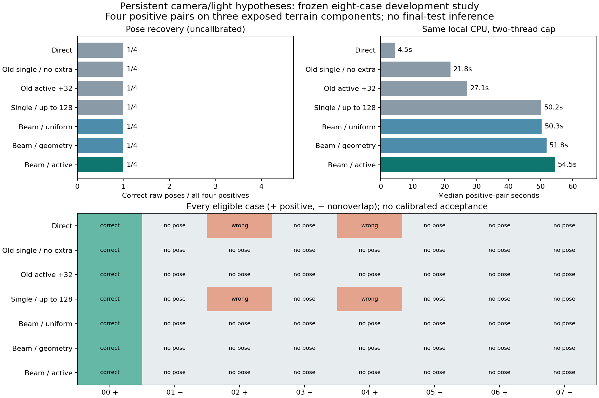

# What the experiments establish

The latest experiment compares seven methods on identical native 512-pixel,
dither-free RGB16 lunar renders. Four positive pairs cover three exposed terrain
components; four nonoverlap pairs record both terrain endpoints. One terrain
component contributes two positive conditions. This is development evidence.

| Method | Correct raw /4 | Strict /4 | Wrong positive | Nonoverlap /4 | Median positive seconds |
|---|---:|---:|---:|---:|---:|
| Direct | 1 | 1 | 2 | 0 | 4.53 |
| Single, no extra | 1 | 1 | 0 | 0 | 21.77 |
| Previous active +32 | 1 | 1 | 0 | 0 | 27.06 |
| Single, full field cap | 1 | 1 | 2 | 0 | 50.17 |
| Beam, uniform | 1 | 1 | 0 | 0 | 50.35 |
| Beam, geometry | 1 | 1 | 0 | 0 | 51.82 |
| Beam, active | 1 | 1 | 0 | 0 | 54.52 |

Correct: rotation <=2° and translation <=1% of median Euclidean reference range.
Strict: <=0.5° and <=0.1%. Every eligible pair remains in the denominator. Raw
outputs are experimental hypotheses; acceptance has not been calibrated.

## Controls that matter

The new single and beam methods share a 128-field total allowance and reference
candidate universe. A field is one actual branch-specific correlation attempt.
Eight branches therefore receive sixteen measurement rounds. Missing support is
charged. The estimator remains AP3P/RANSAC with at least six matches and a
three-native-pixel reprojection threshold. Neither confidence nor pose-success
thresholds changed. The old three controls reproduce all 24 earlier decisions.

Active selection ties uniform and geometry selection, and every method recovers
the same bright positive. The beam has no recovery advantage over the strongest
matched control. Its median time is 2.50 times the no-extra control's time.

## Failure mechanisms identified

1. **Illumination coverage does not ensure camera coverage.** The faint case now
   retains its correct catalogue illumination. Its closest retained initial camera
   remains 364.51m and 12.11° from truth, and acquisition produces no correct final pose.
2. **Correspondence precision does not determine pose accuracy by itself.** The
   strong single control returns 123 correspondences within two native pixels over
   the positive roster, but two poses still exceed translation limits: 17.42m versus
   13.13m, and 31.29m versus 15.88m. Spatial distribution and geometric conditioning matter.
3. **The handoff to final geometry needs investigation.** Saved single-control
   trajectories visit accurate intermediate soft cameras on those two nearly uniform
   cases. Their final AP3P outputs are wrong. Oracle-selected intermediate states
   cannot be counted as method successes. No failed case contains a correct final
   beam branch for a different final branch ranking to select.

These facts motivate separate experiments on proposal coverage, adaptive allocation
of measurements and uncertainty in correspondence-to-pose fitting. They do not
prove that any proposed replacement will improve recovery.

## Uncertainty and remaining work

All 27 paired terrain-component bootstrap draws have a zero recovery difference.
This describes the sample; it does not establish population equivalence. Negative
resampling weights both terrain endpoints, with 5,070 undefined no-edge draws.
Four negatives cannot establish a 1% deployment-error guarantee.

The study adds zero trainable parameters and selects lighting from a discrete
reference catalogue. Height-perturbed selection previews are a geometric proxy;
they do not certify solar visibility. No modern pretrained model was run on this
clean roster, and historical dithered comparisons cannot supply that ranking.
Real orbital navigation accuracy remains unverified. Four calibration and twelve
final terrain groups remain unused.

Source/data freeze preceded inference. All 56 method/case cells independently
replay; the actual controller used 1,238.06 seconds within its approved 1,800-second
cap. The full cap remains charged. This cleanup performs no new lunar inference.

[Full original report](../reports/solar-beam-v144/README.md) ·
[Machine-readable evidence](../reports/solar-beam-v144/results.json) ·
[Reproducible release](https://github.com/ThomasdeChillaz/lunar-image-matching/releases/tag/solar-beam-v144-development)
