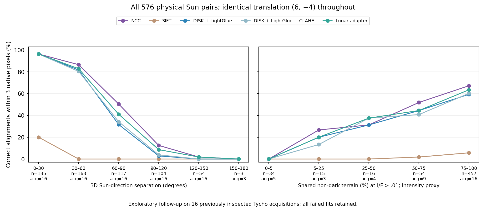

# Physical lighting with fixed geometry

All 576 Sun pairs from 16 previously inspected Tycho acquisitions were evaluated with 5 unchanged methods (2,880 method evaluations). Every combination of the nine source lighting renders is included. The same known translation (6,-4) and zero rotation is applied to every case; gamma, gain and noise remain unchanged. NCC is therefore within its translation model. The learned feature methods retain their original shared partial-affine estimator.

The complete design, source images, model and original development policies were frozen before these new outcomes. Neither retraining nor test-based threshold selection occurs. This is exploratory follow-up on previously inspected terrain, not a fresh geographic holdout. The earlier anchor-light experiment and its negative real-image transfer results remain unchanged.

Sun separation spans 13.52–155.64°. There are 161 cases at 90° or more. The original anchor-light experiment stopped at 77.94° on test cases. Raw non-dark support is measured on corresponding terrain before the known shift; I/F>.01 is an intensity proxy, not a shadow annotation.

| Method | Correct / pairs | Returned / pairs | Median error among returned (px) | Dark-input pairs |
|---|---:|---:|---:|---:|
| NCC | 344/576 | 455/576 | 1.00 | 24 |
| SIFT | 27/576 | 27/576 | 0.29 | 24 |
| DISK + LightGlue | 303/576 | 447/576 | 1.01 | 24 |
| DISK + LightGlue + CLAHE | 305/576 | 473/576 | 1.16 | 24 |
| Lunar adapter | 323/576 | 457/576 | 0.98 | 24 |

The adapter-minus-frozen success difference is 3.47 percentage points; an exploratory bootstrap interval is [1.48, 5.23] percentage points over 15 components joining overlapping footprints and shared acquisitions. Cases share terrain and images. This interval does not establish independent real-image transfer or global lunar superiority.

| Sun separation | Pairs | Acquisitions | NCC correct | SIFT correct | Frozen correct | CLAHE correct | Adapter correct |
|---|---:|---:|---:|---:|---:|---:|---:|
| 0–30° | 135 | 16 | 130 | 27 | 130 | 130 | 130 |
| 30–60° | 163 | 16 | 141 | 0 | 133 | 131 | 135 |
| 60–90° | 117 | 16 | 59 | 0 | 37 | 40 | 48 |
| 90–120° | 104 | 16 | 13 | 0 | 3 | 4 | 9 |
| 120–150° | 54 | 16 | 1 | 0 | 0 | 0 | 1 |
| 150–180° | 3 | 3 | 0 | 0 | 0 | 0 | 0 |

## Transported rejection policies

The policies below were selected on the original physical development cases and are applied unchanged. They are not recalibrated on these follow-up outcomes. Counts concern same-terrain positives; original known non-overlap negatives remain a separate experiment.

| Method | Correct fits retained | Incorrect fits accepted |
|---|---:|---:|
| NCC | No original development policy | — |
| SIFT | 14/27 | 0 |
| DISK + LightGlue | 5/303 | 7 |
| DISK + LightGlue + CLAHE | 249/305 | 37 |
| Lunar adapter | 242/323 | 25 |

A concrete failure is visible in the original frozen learned policy: its translation limit is 0.05 of the image size, while the exact imposed translation has magnitude 0.05634. The correct transform itself exceeds that selected bound. This helps explain rejection of valid fits and shows that the old policy does not transport reliably to this design. The threshold is left unchanged; a replacement needs development-only design and a fresh evaluation, not selection from these inspected outcomes.

Failures to return a fit stay in correctness denominators. A low error median among returned fits does not compensate for missing fits. Dark inputs remain explicit failures when unmatchable; no stable terrain coordinates are invented from darkness.

Evidence: [per-method outcomes](crosslighting_results.csv), [all strata](crosslighting_strata.csv), [summary and paired uncertainty](crosslighting_summary.json), [pixel/geometry audit](crosslighting_audit.json). The audit reconstructs the known image translation by array slicing, checks exact image/mask hashes and recomputes every saved error and gate decision.

Source data: Grethen et al., [MoonAnything](https://arxiv.org/html/2604.00682v1), [Zenodo 18415119](https://zenodo.org/records/18415119), CC BY 4.0. Independent human landmarks and real-data rejection calibration remain open. No NASA/JPL affiliation or navigation certification is implied.
