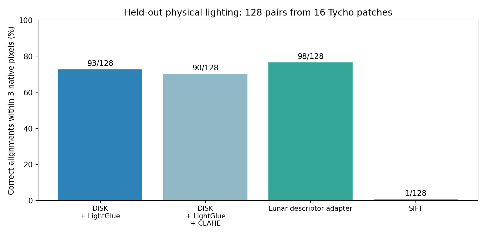
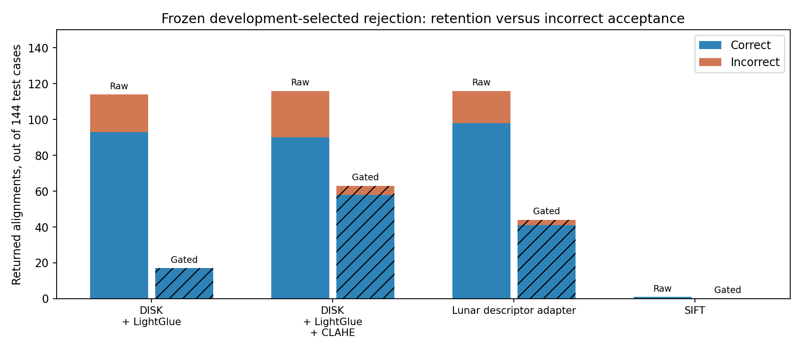
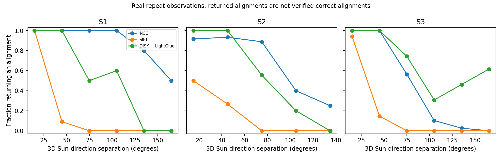

# Lunar research extension: measured results

The expanded benchmark and physical-render adaptation experiment have executed. Independent real-image reference validation and real-image adaptation transfer remain open. The original pilot is preserved.

## Physical lighting and adaptation

MoonAnything Hapke renders: 48 training patches/acquisitions, 16 development patches/acquisitions, 16 held-out patches/acquisitions. Geographic longitude bands have wide gaps and source acquisitions do not cross splits. This is within-Tycho geographic transfer. Each evaluation patch has eight lighting/known-warp pairs and one disjoint-terrain negative. Native resolution is 128px. All-zero renders stay in evaluation; uninformative descriptors are excluded from training.

A 128×128 linear descriptor projection (16,384 trainable parameters) was fitted on 358 physical training pairs. DISK detection/backbone and LightGlue stayed frozen. Checkpoint 300 was selected using 126 development descriptor pairs; test outcomes were not used for selection.

| Method | Correct / 128 | Median error among returned (px) | P95 among returned (px) | Non-overlap cases returning a fit / 16 |
|---|---:|---:|---:|---:|
| DISK + LightGlue | 93 | 1.23 | 7.77 | 2 |
| DISK + LightGlue + CLAHE | 90 | 0.98 | 16.51 | 1 |
| Lunar descriptor adapter | 98 | 0.97 | 4.09 | 4 |
| SIFT | 1 | 0.37 | 0.37 | 0 |

The adapter gains 3.91 percentage points over the frozen learned matcher. An exploratory source-acquisition-clustered bootstrap interval is [-2.34, 10.94] percentage points (16 groups). This small synthetic experiment does not establish statistical superiority across lunar regions or transfer to real imagery. SIFT uses its original default preset on low-contrast 128px inputs; no SIFT tuning is claimed.

## Rejection trade-off

Each method’s policy was selected from development outcomes with zero accepted incorrect development outcomes. Policies were saved before test evaluation. That development constraint did not generalize perfectly:

| Method | Correct fits retained | Incorrect fits accepted | Disjoint-terrain fits accepted / 16 |
|---|---:|---:|---:|
| SIFT | 0/1 | 0 | 0/16 |
| DISK + LightGlue | 17/93 | 0 | 0/16 |
| DISK + LightGlue + CLAHE | 58/90 | 5 | 0/16 |
| Lunar descriptor adapter | 41/98 | 3 | 0/16 |

Both rejection errors and discarded correct fits matter. Zero accepted disjoint-terrain fits in 16 cases is not a safety guarantee. Incorrect physical outcomes include failed registrations; the plot separates returned incorrect alignments from failures to return any fit.

## Real repeat observations and Sun direction

All 42 CNSFM source observations and 321 image pairs were evaluated with three methods and none/CLAHE preprocessing: 1,926 bidirectional evaluations. Sun direction is derived at each crop center from archived LROC subsolar metadata, retaining source-page hashes and 0.01° metadata resolution. It is a spherical geometric direction, not terrain illumination or a fresh SPICE solution. The plot uses 3D separation, so an azimuth flip near solar zenith is not mistaken for opposite illumination.

Source-map co-registration uncertainty is unknown. The following primary, no-CLAHE results describe provisional map disagreement, not true registration accuracy:

| Scene | Method | Returned / pairs | Median map disagreement among returned (px) |
|---|---|---:|---:|
| S1 | NCC | 43/45 | 59.03 |
| S1 | SIFT | 13/45 | 17.91 |
| S1 | DISK + LightGlue | 31/45 | 24.06 |
| S2 | NCC | 36/45 | 6.56 |
| S2 | SIFT | 10/45 | 9.54 |
| S2 | DISK + LightGlue | 33/45 | 5.31 |
| S3 | NCC | 102/231 | 13.68 |
| S3 | SIFT | 38/231 | 12.91 |
| S3 | DISK + LightGlue | 158/231 | 20.68 |

All pairs within a scene share observations and terrain, so pair-wise confidence intervals would exaggerate independent evidence. S3 was inspected in the pilot; new results there are exploratory. Real bright-overlap measurements are explicitly intensity-threshold proxies on the provisional map grid. They will be recomputed using independently reviewed alignment when available.

## Original CNSFM and open acceptance

The authors’ pinned Windows executable completed a native-input probe in all three regions. Output coordinates were audited against the published detector files, including the executable’s window-local ID convention. The released YOLOv9 crater checkpoint was separately run on all 42 identical masked 512px inputs. Common-grid CNSFM execution, shared-geometry scoring and the final comparison remain open until the Windows run is verified. Whole-image redetection at the common resolution differs from the authors’ native tiled detector pipeline; no paper-percentage reproduction is claimed.

The blank, source-bound [landmark review packet](landmark_review.html) requires human input. It supports 10–20 distributed landmarks, per-image uncertainty, explicit unscorable cases and optional independent second review. No generated or matcher-derived coordinates have been imported as independent references. Real-data rejection calibration, verified registration accuracy and real-image adaptation transfer remain open.

## Reproducibility and provenance

See [measurement audit](extension_audit.json), [per-evaluation real diagnostics](expanded_results.csv), [physical measurements](physical_results.csv), [adapter](lunar_adapter.json), [frozen policies](frozen_policies.json) and [paired uncertainty](paired_uncertainty.json). Original complete run JSON remains under the fresh run directories; published CSV omits bulky feature-coordinate arrays. Inference sources, input hashes, model locks and metric recomputation were audited. Cached learned extraction timings are descriptive and are not a fair cross-hardware speed comparison.

Physical data: Grethen et al., [MoonAnything](https://arxiv.org/html/2604.00682v1), [Zenodo 18415119](https://zenodo.org/records/18415119), CC BY 4.0. Real imagery: [CNSFM research release](https://github.com/Bin501/CNSFM), [Li et al. 2025](https://doi.org/10.3390/rs17132302). No NASA/JPL affiliation or navigation certification is implied.

Generated from saved measurements at 2026-10-29T10:58:56.534712+00:00.
