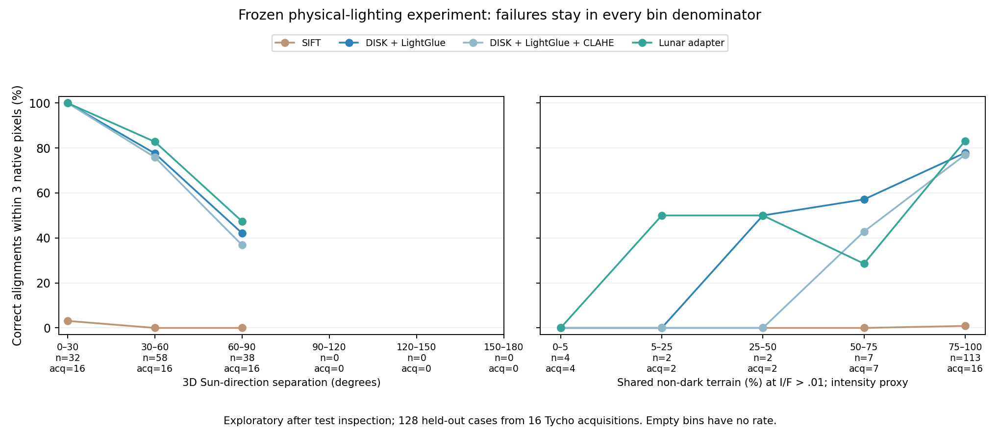

# Lunar research extension: measured results

The expanded benchmark, physical-render adaptation and the additional experiments listed below have executed. Independent real-image reference validation and verified real-image adaptation gains remain open. The original pilot is preserved.

## Physical lighting and adaptation

MoonAnything Hapke renders: 48 training patches/acquisitions, 16 development patches/acquisitions, 16 held-out patches/acquisitions. Geographic longitude bands have wide gaps and source acquisitions do not cross splits. This is within-Tycho geographic transfer. Each evaluation patch has eight lighting/known-warp pairs and one disjoint-terrain negative. Native resolution is 128px. All-zero renders stay in evaluation; uninformative descriptors are excluded from training.

A 128×128 linear descriptor projection (16,384 trainable parameters) was fitted on 358 physical training pairs. DISK detection/backbone and LightGlue stayed frozen. Checkpoint 300 was selected using 126 development descriptor pairs; test outcomes were not used for selection.

| Method | Correct / 128 | Median error among returned (px) | P95 among returned (px) | Non-overlap cases returning a fit / 16 |
|---|---:|---:|---:|---:|
| DISK + LightGlue | 93 | 1.23 | 7.77 | 2 |
| DISK + LightGlue + CLAHE | 90 | 0.98 | 16.51 | 1 |
| Lunar descriptor adapter | 98 | 0.97 | 4.09 | 4 |
| SIFT | 1 | 0.37 | 0.37 | 0 |

The adapter gains 3.91 percentage points over the frozen learned matcher. An exploratory bootstrap interval is [-2.50, 10.42] percentage points (15 components across 16 source acquisitions). Overlapping declared terrain footprints and shared acquisitions are joined before resampling; an earlier source-only grouping did not account for one overlapping pair. This small synthetic experiment does not establish statistical superiority across lunar regions or transfer to real imagery. SIFT uses its original default preset on low-contrast 128px inputs; no SIFT tuning is claimed.

## Physical illumination and shared terrain support

The following analysis recomputes 3D Sun-direction separation from the physical render metadata and joint non-dark support from the exact raw render bytes. Every failed fit stays in its bin denominator. Bin edges are fixed round intervals for this descriptive analysis after test inspection; no model or rejection threshold is retuned. The same source acquisition contributes multiple lighting cases, so pair counts are not independent sample sizes. The frozen experiment also couples light index to rotation; these strata do not isolate a causal illumination effect.

| Held-out condition | Pairs | Acquisitions | Frozen correct | Adapter correct |
|---|---:|---:|---:|---:|
| Sun separation 0–30° | 32 | 16 | 32/32 | 32/32 |
| Sun separation 30–60° | 58 | 16 | 45/58 | 48/58 |
| Sun separation 60–90° | 38 | 16 | 16/38 | 18/38 |
| Non-dark support 0–5% | 4 | 4 | 0/4 | 0/4 |
| Non-dark support 5–25% | 2 | 2 | 0/2 | 1/2 |
| Non-dark support 25–50% | 2 | 2 | 1/2 | 1/2 |
| Non-dark support 50–75% | 7 | 7 | 4/7 | 2/7 |
| Non-dark support 75–100% | 113 | 16 | 88/113 | 94/113 |

The held-out physical Sun separations span only 21.09–77.94°. No cases test 90° or larger Sun separations. The training anchor design likewise stays below 80.72° before co-visible feature filtering. This is a coverage limitation, not evidence that the model generalizes to opposite lighting.

Shared non-dark support means both raw renders exceed I/F=.01 at the same valid terrain pixel before the known warp. It is an intensity proxy, not a geometric Sun-visibility or shadow mask. A case without jointly valid terrain would remain unknown rather than be labelled dark. Most cases have high shared support; sparse low-support bins cannot establish robust shadow invariance.

| Raw I/F threshold | Cases with <25% shared support | Acquisitions | Frozen correct | Adapter correct |
|---|---:|---:|---:|---:|
| 0 | 6 | 6 | 0/6 | 1/6 |
| 0.005 | 6 | 6 | 0/6 | 1/6 |
| 0.01 | 6 | 6 | 0/6 | 1/6 |
| 0.02 | 7 | 6 | 1/7 | 2/7 |

The support-threshold sensitivity changes membership of a descriptive subset, not any saved matching outcome. Known non-overlap negatives remain in the rejection analysis below; they have no shared terrain or physical Sun-pair reference and are excluded from these positive-case strata. See [all strata and denominators](physical_lighting_strata.csv) and [input hashes, pair metadata and design coverage](physical_lighting_analysis.json).

## Every Sun pair with fixed geometry

A completed follow-up evaluates every one of the 576 physical Sun pairs with the same known translation (6,-4) and zero rotation throughout (2,880 method evaluations). This removes the earlier coupling between light index and rotation. It includes 161 pairs at Sun separations of 90° or more. The existing models and original development policies stay unchanged. NCC is included within its translation model, alongside SIFT and the frozen learned variants.

The design was frozen before the new outcomes, but the terrain was inspected previously: this is an exploratory controlled follow-up, not a fresh geographic holdout. No model or threshold is selected from the new results.

| Method | Correct / pairs | Returned / pairs |
|---|---:|---:|
| NCC | 344/576 | 455/576 |
| SIFT | 27/576 | 27/576 |
| DISK + LightGlue | 303/576 | 447/576 |
| DISK + LightGlue + CLAHE | 305/576 | 473/576 |
| Lunar descriptor adapter | 323/576 | 457/576 |

The unchanged frozen learned rejection policy retains only 5 of 303 correct fits and accepts 7 incorrect fits in this follow-up. Its selected translation bound is smaller than the exact known displacement. The old policy is therefore not a reliable quality filter for this design; it remains experimental. No replacement is selected from these test outcomes.

See the [fixed-geometry report](CROSS_LIGHTING_REPORT.md) for per-Sun-bin counts, transported-policy errors, grouped uncertainty and an audit that reconstructs the exact translation by slicing the source pixels. These physical results do not establish independent real-image accuracy.

## Rejection trade-off

Each method’s policy was selected from development outcomes with zero accepted incorrect development outcomes. Policies were saved before test evaluation. That development constraint did not generalize perfectly:

| Method | Correct fits retained | Incorrect fits accepted | Disjoint-terrain fits accepted / 16 |
|---|---:|---:|---:|
| SIFT | 0/1 | 0 | 0/16 |
| DISK + LightGlue | 17/93 | 0 | 0/16 |
| DISK + LightGlue + CLAHE | 58/90 | 5 | 0/16 |
| Lunar descriptor adapter | 41/98 | 3 | 0/16 |

Both rejection errors and discarded correct fits matter. Zero accepted disjoint-terrain fits in 16 cases is not a safety guarantee. Incorrect physical outcomes include failed registrations; the plot separates returned incorrect alignments from failures to return any fit.

## Real repeat observations and Sun direction

All 42 CNSFM source observations and 321 image pairs were evaluated with three methods and none/CLAHE preprocessing: 1,926 bidirectional evaluations. Sun direction is derived at each crop center from archived LROC subsolar metadata, retaining source-page hashes and 0.01° metadata resolution. It is a spherical geometric direction, not terrain illumination or a fresh SPICE solution. The plot uses 3D separation, so an azimuth flip near solar zenith is not mistaken for opposite illumination.

Source-map co-registration uncertainty is unknown. The following primary, no-CLAHE results describe provisional map disagreement, not true registration accuracy:

| Scene | Method | Returned / pairs | Median map disagreement among returned (px) |
|---|---|---:|---:|
| S1 | NCC | 43/45 | 59.03 |
| S1 | SIFT | 13/45 | 17.91 |
| S1 | DISK + LightGlue | 31/45 | 24.06 |
| S1 | Original CNSFM / common grid | 45/45 | 23.74 |
| S1 | Lunar descriptor adapter | 31/45 | 22.81 |
| S2 | NCC | 36/45 | 6.56 |
| S2 | SIFT | 10/45 | 9.54 |
| S2 | DISK + LightGlue | 33/45 | 5.31 |
| S2 | Original CNSFM / common grid | 42/45 | 6.22 |
| S2 | Lunar descriptor adapter | 31/45 | 5.19 |
| S3 | NCC | 102/231 | 13.68 |
| S3 | SIFT | 38/231 | 12.91 |
| S3 | DISK + LightGlue | 158/231 | 20.68 |
| S3 | Original CNSFM / common grid | 115/231 | 11.84 |
| S3 | Lunar descriptor adapter | 99/231 | 13.19 |

All pairs within a scene share observations and terrain, so pair-wise confidence intervals would exaggerate independent evidence. S3 was inspected in the pilot; new results there are exploratory. Real bright-overlap measurements are explicitly intensity-threshold proxies on the provisional map grid. They will be recomputed using independently reviewed alignment when available.

## Original CNSFM and open acceptance

The authors’ pinned Windows executable completed all 642 executions: 321 pairs independently matched forward and reverse. All ten shards, ordered source inputs, exact pixel/mask hashes, crater IDs and original output hashes were audited before applying the same one-to-one filtering and partial-affine RANSAC (3px, six inliers) as the other feature methods. Execution failures cannot disappear from denominators. See [Windows artifact hashes](cnsfm_windows_artifacts.json) and [common-protocol audit](cnsfm_common_audit.json).

The released YOLOv9 crater checkpoint produced 2,213 predictions on all 42 identical masked 512px inputs. Whole-image redetection differs from the authors’ native tiled detector pipeline. The paper reports native-input success rates of 100%, 100% and 72.3% for S1/S2/S3, using more than three correct matches as success. Our shared six-inlier geometry criterion, resolution and provisional map scoring differ; neither the published percentages nor our returned-fit rates establish a directly comparable accuracy ranking. No paper-percentage reproduction is claimed.

The blank, source-bound [landmark review packet](landmark_review.html) requires human input. It supports 10–20 distributed landmarks, per-image uncertainty, explicit unscorable cases and optional independent second review. No generated or matcher-derived coordinates have been imported as independent references. Real-data rejection calibration, verified registration accuracy and verified real-image adaptation improvement remain open.

## Additional real regions and adapter transfer

A checksummed 4.68 GB appearance archive supplied real orthorectified LRO crops, distinct from the Hapke renders. Metadata-only selection froze 54 images from 32 source acquisitions and 27 repeat pairs in five separated Tycho boxes (11 dev, 16 test). No acquisition occurs in the physical train/dev/test sample; no selected real footprint overlaps physical training or development terrain. Real dev/test source groups and footprints are separated. The selection used overlap and Sun-angle strata before matcher outcomes, with available stratum counts retained rather than filled with favorable matches.

Each 128px common grid covers the metadata intersection of two original 128px appearance crops. This resampling and geolocation are provisional. These five areas add real terrain beyond the original three CNSFM scenes, but they do not represent five globally independent lunar regions. Physical test terrain may overlap; this transfer experiment is exploratory. The adapter and physical rejection policies were frozen before real outcomes. Transporting a policy is not real-data calibration.

| Real split | Method | Returned / pairs | Median map disagreement among returned (128-grid px) | Accepted by transported physical policy |
|---|---|---:|---:|---:|
| dev | SIFT | 0/11 | — | 0 |
| dev | DISK + LightGlue | 11/11 | 4.69 | 1 |
| dev | DISK + LightGlue + CLAHE | 11/11 | 5.08 | 3 |
| dev | Lunar descriptor adapter | 11/11 | 4.78 | 1 |
| test | SIFT | 0/16 | — | 0 |
| test | DISK + LightGlue | 16/16 | 5.64 | 0 |
| test | DISK + LightGlue + CLAHE | 15/16 | 6.35 | 5 |
| test | Lunar descriptor adapter | 15/16 | 5.86 | 4 |

Results vary by area and do not establish consistent real-image improvement. A lower median among returned fits can also hide failures. Neither acceptance nor map agreement proves a correct registration. Independent landmarks are required to resolve this. See [real Tycho measurements](tycho_results.csv) and [input/geometry audit](tycho_transfer_audit.json).

The same frozen adapter was also evaluated on all 321 original CNSFM pairs at the common 512px resolution. Its measurements appear in the scene table above and [real adapter measurements](real_adapter_results.csv); see the [real adapter audit](cnsfm_transfer_audit.json). No physical 128px policy was silently rescaled to 512px. Human annotations from the pilot can be converted through known map-grid affines to score the corresponding pair subset; matcher-estimated transforms never supply that conversion.

**The current adapter is not supported as a real-image improvement.** On polar S3 it returns only 99/231 fits versus 158/231 for the frozen matcher, a loss of 59 returned alignments. A lower map-disagreement median among its surviving fits cannot offset that missing coverage or establish better accuracy. Keep the frozen matcher as the default; retain the adapter as an experimental result. Future adaptation should be tested across image scales and constrained against descriptor collapse using development data, with a fresh geographic holdout for any subsequent claim.

## Reproducibility and provenance

See [measurement audit](extension_audit.json), [per-evaluation real diagnostics](expanded_results.csv), [physical measurements](physical_results.csv), [adapter](lunar_adapter.json), [frozen policies](frozen_policies.json) and [paired uncertainty](paired_uncertainty.json). Original complete run JSON remains under the fresh run directories; published CSV omits bulky feature-coordinate arrays. Inference sources, input hashes, model locks and metric recomputation were audited. Cached learned extraction timings are descriptive and are not a fair cross-hardware speed comparison.

Physical data: Grethen et al., [MoonAnything](https://arxiv.org/html/2604.00682v1), [Zenodo 18415119](https://zenodo.org/records/18415119), CC BY 4.0. Real imagery: [CNSFM research release](https://github.com/Bin501/CNSFM), [Li et al. 2025](https://doi.org/10.3390/rs17132302). No NASA/JPL affiliation or navigation certification is implied.

Generated from saved measurements at 2026-10-29T20:25:46.787527+00:00.
