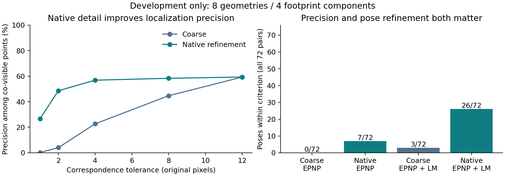
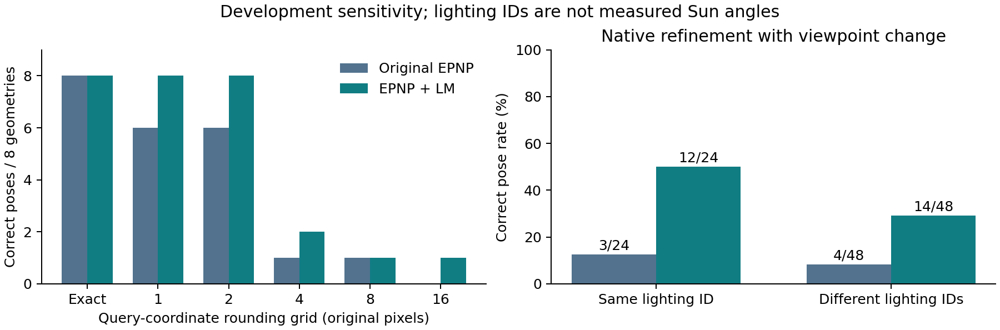

# Localization development diagnosis - iteration 7

This is a completed development diagnosis and a failed fresh-data gate, not a trained compact-v3 model or a held-out improvement claim. The compact-v2 release and all earlier results remain unchanged.

## Measured findings

Eight model-selection geometries from four selected footprint components give 72 stereo/light combinations. Repeated lighting cases are dependent. All eligible cases, including missing poses, remain in denominators. Correct pose means rotation <=2 degrees and translation <=1% of median reference ray range; this is a simulated diagnostic, not a spacecraft requirement.

| Frontend | Original EPNP/RANSAC | Same initialization + inlier LM refit |
|---|---:|---:|
| Frozen coarse matcher | 0/72 | 3/72 |
| Deterministic native refinement | 7/72 | 26/72 |

The original-estimator experiment was specified before inference. The LM experiment is a separate, post-diagnostic development ablation. It is standard nonlinear optimization, not a new learned method. Neither modifies the historical v2 estimator.

Exact projected correspondences recover 8/8 poses, passing the 95% software gate. With the original estimator, rounding correct query coordinates to a 16-original-pixel grid gives 0/8. Native descriptor search improves precision within 2 original pixels from 4.06% to 48.57% among co-visible reference points. Both return 22,697 matches, of which 14,938 reference points are co-visible. Conditional correspondence precision does not count non-visible predictions as correct.

Native refinement plus LM recovers 12/24 same-light and 14/48 changing-light poses. The stricter 0.5-degree/0.1%-range criterion is met in only 1/72 predicted cases. The current system is still weak. LM also loses an oracle-noise case at each of sigma=1 and sigma=2 pixels, so it is not universally better. These findings support investigating both coordinate precision and pose conditioning; neither is the sole established cause.




## Fresh-data gate: failed before training

The complete released SouthPole inventory contains 76,802 NPZ camera files, 12,974 stereo geometries and 12,454 complete three-light geometries. Every NPZ contains only intrinsics and cam2world. There are no released trajectory, generation-batch or Sun-angle fields. The outer StereoGeo archive was checked again: TychoCrater is an empty directory.

The conservative fallback keeps each complete mode/folder together. All three fallback groups were already exposed in v2; zero qualify as fresh under that grouping, versus 12 required. Modes are not asserted to be actual trajectory identities. This does not prove that no unused spatial terrain exists: it establishes that the requested batch/trajectory-conservative fresh split cannot be certified from this release. No full-depth fresh-footprint count or trajectory independence is claimed.

Per the accepted plan, compact-v3 training, seed trials, new final-test inference, modern pose rankings, transfer evaluation and a superiority paper are deferred. No model-version alias or untrained checkpoint is published as a working compact-v3 model. LuSNAR scenes7-9 remain the intended transfer reserve; their files/cases have not been acquired or frozen, and no transfer result is claimed.

## Reproduction and audit

Use the validated requirements-lock environment. Large original archives, v2 checkpoints and depth caches are provided through their existing provenance and compact-v2 release assets. The new measurement capsule contains both diagnostic attempts, protocols, saved correspondences, the full compressed camera inventory and replay results. The first attempt predates a non-numerical lazy-import cleanup; the validated run is the one reported here. Both have identical count outcomes. No numerical method or threshold was selected between those executions.

```bash
python localization_data_v3.py --output reports/new_data_gate.json --records runs/new_inventory.jsonl.gz
python localization_diagnostics_v3.py --output runs/new_localization_diagnosis
python localization_pose_refit_v3.py --source runs/new_localization_diagnosis --output reports/new_pose_refit.json
python verify_localization_v3.py --run runs/new_localization_diagnosis --gate reports/new_data_gate.json --output reports/new_localization_audit.json
python verify_localization_pose_refit_v3.py --input reports/new_pose_refit.json --output reports/new_refit_audit.json
```

Independent projection/visibility/pose-error replay checks 312 rows and 15 aggregate tables. A separate refit replay checks another 312 saved poses and 15 tables. The full 76,802-record camera inventory is checked. Repository verification: 137 tests passed, four optional tests skipped; a fresh procedural smoke produced 20 summaries.

Runtime includes separate native feature extraction: 48 native feature maps were measured, with total cost preserved in summary.json. Per-case refinement timings exclude that cache-building cost and must not be advertised as end-to-end speed. No accepted-error or risk-coverage claim is available: no new acceptance policy or nonoverlap pose experiment was fitted/run.

## What permits the next phase

Obtain verified generation-batch/trajectory membership and sufficient untouched footprint groups, or additional independently characterized 3D relighting data satisfying the same split contract. Re-audit the data before training. Then compare the learned module against BOTH native descriptor refinement and pose refitting, train using true 3D visibility/correspondences, and reserve all new final cases until model/policy freeze. No human review or paid compute is required by the diagnostic stage.

## Related work

- [Rothenberger et al., Illumination Invariant Image Matching for Lunar TRN](https://doi.org/10.2514/6.2025-2073): related motivation; no LIMA reproduction or direct paper-percentage comparison is claimed.
- [RoMa v2](https://arxiv.org/html/2511.15706): subpixel refinement and predictive covariance already exist.
- [Semi-Dense Matching Uncertainty Is Not Just Local Confidence](https://arxiv.org/abs/2608.08685): coarse-failure uncertainty is existing work.
- [MOONSt3R](https://github.com/clementinegrethen/StereoLunar): relevant lunar-adapted comparison for the future study; not executed here.
- [LunarGeo release](https://zenodo.org/records/18415119): source cameras, renders and ray-depth.
