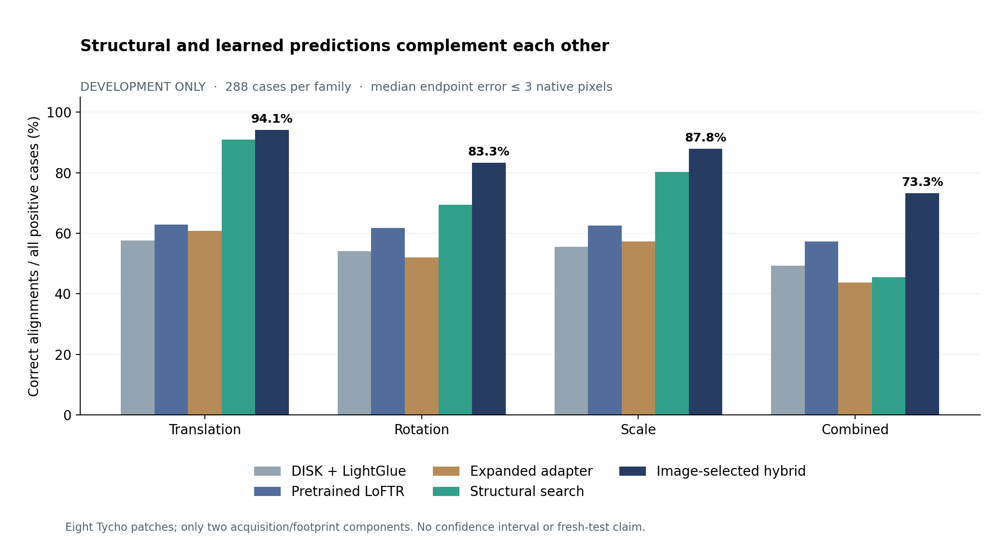
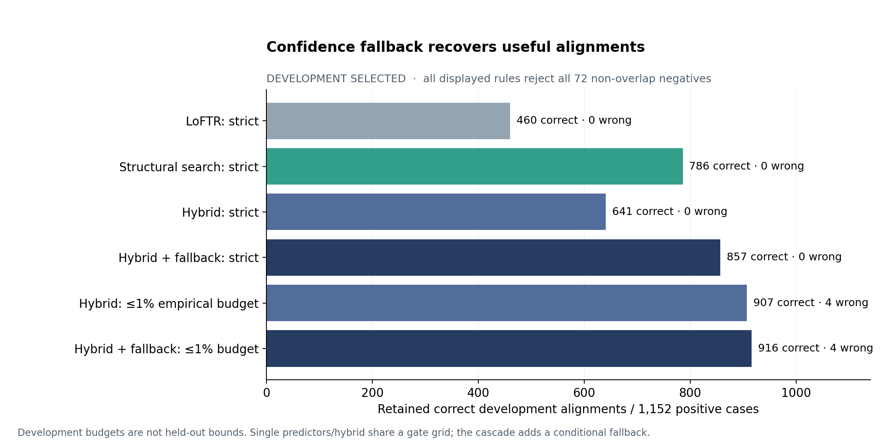

# Research iteration 2: complementary matching and confidence fallback

Development experiments completed 29–30 October 2026. No fresh geographic reserve has been evaluated. No state-of-the-art superiority or independently verified real navigation accuracy is claimed.

## Question and protocol

Can image-only structural agreement select complementary classical/learned alignments under lunar illumination changes, rotation and scale? Can confidence-based fallback retain more correct alignments without increasing development false acceptance?

The common development protocol uses eight predetermined Tycho patches, all 36 unordered pairs of nine physical Sun renders, and four separately seeded motion families: 1,152 positive cases plus 72 disjoint-terrain negatives. Images and masks are identical across methods, native resolution is 128×128, and success means median valid-point endpoint error ≤3 native pixels, with failed registrations retained in denominators. Rotation spans ±30°, scale .75–1.3, and applicable translation ±12px. Synthetic geometric warps supply exact supervision; physical rendering supplies illumination change. This is not spacecraft perspective navigation.

Although there are many repeated lighting/motion cases, the development terrain has only **two acquisition/overlapping-footprint components**. No confidence interval treating the 1,152 pairs as independent is justified. Both 32-patch geographic reserves remain unused; all four geographic bands are within Tycho.

## Completed common development results

| Method | Translation /288 | Rotation /288 | Scale /288 | Combined /288 | Non-overlap fits /72 |
|---|---:|---:|---:|---:|---:|
| DISK + LightGlue | 166 | 156 | 160 | 142 | 19 |
| Pretrained LoFTR | 181 | 178 | 180 | 165 | 0 |
| Expanded trained adapter | 175 | 150 | 165 | 126 | 8 |
| Structural similarity search | 262 | 200 | 231 | 131 | 0 |
| Image-selected hybrid, global score | **271** | **240** | **253** | **211** | **40** |



The hybrid is correct on **975/1,152 positives (84.64%)**, compared with LoFTR **704/1,152 (61.11%)**: a development difference of **23.52 percentage points**. It selects among eight predictions using post-alignment image evidence, not correctness, known motion or geometry-family labels. The balanced/consensus variants reach 974, so the current experiments do not establish a benefit from the added orientation/agreement weights.

Raw hybrid coverage is not reliability: it returns 40 alignments on known non-overlap negatives, versus zero for structural search and LoFTR. Rejection must therefore be included in the comparison. The structural search returned 824 alignments, all correct in this development run; its 328 positive failures and all negative rejections remain in the full denominators. This does not guarantee future precision.

Expanded training improved descriptor loss but **did not improve overall registration**: the new adapter reaches 616 positives versus the frozen DISK/LightGlue model's 624. It remains an experimental complementary predictor, not the default replacement. The earlier adapter and old fixed-translation benchmark are separate experiments.

## Rejection and conditional fallback

Every single predictor and the hybrid receives the same development-only image-evidence gate grid: structural correlation, local patch correlation, joint non-dark support, valid image support, independent predictor-family agreement and separately estimated reverse cycle. No ground-truth error, known motion, maximum-displacement limit or zero-by-construction template residual enters inference.

The original strict adapter diagnostic policy rejected everything. Actual image evidence enables useful policies, but selecting among 14,400 rules on only two geographic components can overfit. The empirical budgets below are development selection constraints, not held-out error bounds.

| Method and development budget | Retained correct | Accepted wrong | Accepted non-overlap |
|---|---:|---:|---:|
| LoFTR, zero observed error | 460 | 0 | 0/72 |
| Structural search, zero observed error | 786 | 0 | 0/72 |
| Hybrid, zero observed error | 641 | 0 | 0/72 |
| Hybrid + structural fallback, zero observed error | **857** | **0** | **0/72** |
| LoFTR, ≤1% accepted-error budget | 614 | 6 | 0/72 |
| Hybrid, ≤1% accepted-error budget | 907 | 4 | 0/72 |
| Hybrid + structural fallback, ≤1% budget | **916** | **4** | **0/72** |



The cascade first tries the frozen development-selected hybrid gate; on rejection it applies a separately development-calibrated structural-search gate. Fallback calibration uses only residual development cases. At the strict setting it recovers 216 correct alignments beyond the hybrid gate, yielding 857 retained; the final joint constraint is checked after composition. At the 1% setting it adds nine correct alignments, retaining 916/1,152 positives (79.51%) with four wrong acceptances (4/920=0.435%). All 72 negatives are rejected in development. Both settings remain candidates pending fresh testing.

This is a decision fallback over cached predictions, **not an inference-speed improvement**: all eight candidate methods were already executed. The cascade has more decision freedom than a single gate; the additional stage and selection must be disclosed.

## Stronger baseline check and current literature

The original-author EfficientLoFTR native/2× CPU probe completed on the same first two development patches, including all geometry families. The table below uses only their 288 positive and 18 negative case IDs, so it does not compare a two-patch model result against an eight-patch hybrid result.

| Method on identical two-patch cases | Correct /288 | Non-overlap fits /18 |
|---|---:|---:|
| Pretrained LoFTR | 162 | 0 |
| Original EfficientLoFTR, native | 142 | 0 |
| Original EfficientLoFTR, internal 2× | 182 | 4 |
| Structural similarity search | 213 | 0 |
| Image-selected hybrid | 242 | 9 |

Internal resizing adds no source information. Refined coordinates are converted using pixel centers `(coordinate+.5)/factor-.5` before fitting/scoring on the native grid. Full 2×/4× EfficientLoFTR and author MatchAnything comparisons are running separately on all eight patches. MPS results are explicit variants; CPU/GPU timing and floating-point results are not assumed equivalent.

The author MatchAnything source, default configuration and released ELoFTR configuration are pinned independently. This integration does not silently swap weights into the newer EfficientLoFTR code. It loads all 447 tensors strictly and passes known-transform native/2×/4× tests. The released wrapper's NPE profile is declared for each internal size, and its matchanything branch does not perform the newer EfficientLoFTR reparameterization. Mask filtering, native geometry and internal bilinear resizing are disclosed benchmark adaptations, not reproductions of the paper's other task protocols.

Relevant primary sources:

- [Georgakis and Ansar, 2024 lunar illumination-invariant features](https://seal.ae.gatech.edu/sites/default/files/2024-09/GeorgakisGeorgios.pdf): lunar training and unseen-map evaluation directly motivate the experiment. Their individual-correspondence RA-1/RA-5 metrics are not our pair-level success rate.
- [Rothenberger et al., 2025 lunar TRN](https://doi.org/10.2514/6.2025-2073): LIMA and learned illumination invariance are relevant specialist comparisons; neither is reproduced by the present structural experiments.
- [EfficientLoFTR, CVPR 2024](https://github.com/zju3dv/EfficientLoFTR): stronger semi-dense baseline. The actual downloaded revision uses PRL v1.0; academic/personal/evaluation use is allowed without registration. Do not assume an older license.
- [MatchAnything, 2025](https://arxiv.org/abs/2501.07556): cross-modality pretraining motivates testing structure despite major appearance changes; released source LICENSE is Apache-2.0.
- [MIND, 2012](https://doi.org/10.1016/j.media.2012.05.008): medical multimodal self-similarity motivates the original structural channels. They are not a complete MIND reproduction.
- [RoMa, CVPR 2024](https://github.com/Parskatt/RoMa): dense matching remains an important additional comparison; it has not been evaluated here.

Published terrestrial pose AUC, lunar correspondence precision and this benchmark's pair success are different metrics. Strong development gains over off-the-shelf LoFTR or the limited EfficientLoFTR probe do not establish superiority over current lunar-specialist or dense matchers.

## Completed local-refinement probe

Local four-parameter similarity refinement maximizes image-only structural agreement around the selected transform. Structural features are recomputed after warping grayscale pixels; rotating directional descriptor channels would not be equivalent. Its new support mask excludes the full seven-pixel orientation-feature neighborhood; v1 measurements are preserved unchanged. A brightness-inverted, perturbed known-transform test passes.

The two-patch probe completed: the same-support-mask unrefined control is correct on 242/288 positives; refinement reaches 246/288 (84.03%→85.42%, +1.39 points), with four gained correct cases and no lost correct cases. Translation/rotation/scale/combined counts are 66/60/65/55 of 72, versus 66/59/64/53 before refinement. Both variants still return nine fits on 18 non-overlap negatives. Median endpoint error on the same returned positive cases decreases from .491 to .447px. This is a modest development gain; it does not solve rejection or demonstrate geographic generalization.

All 612 outcomes passed [native-input and geometry audit](refinement_dev_probe_audit.json). The [probe summary](refinement_probe_summary.json), [complete measurement capsule](refinement_probe_v1.zip) and [checksum](refinement_probe_v1.sha256) preserve the separate control/refinement experiment. Extract this additional capsule into `runs/` and audit with `python verify_research_dev.py runs/refinement-dev-probe-v1 --output runs/refinement-recheck.json`. Full eight-patch stronger-baseline experiments remain active.

## Evidence and reproduction

Completed measurements and policies: [machine-readable summary](research_development_v2.json), [geometry CSV](development_geometry_v2.csv). Audits: [geometry search and learned baselines](geometry_dev_audit.json), [adapter](adapter_dev_audit.json), [EfficientLoFTR probe](eloftr_dev_probe_audit.json), [cascade decisions](cascade_dev_audit.json), [equal-grid predictor policies](predictor_quality_dev_audit.json). The completed [blend audit](blend_dev_audit.json) reconstructs every native input and replays all 3,672 image-only choices, including separate reverse selection, while binding all eight upstream predictors. Cascade decisions and predictor confidence calibration also passed their exhaustive saved-outcome audits.

Validation: **95 tests passed**, including actual DISK/LightGlue, LoFTR, original EfficientLoFTR and author MatchAnything inference; the new refinement and cascade controls passed. A fresh procedural smoke run produced 20 summaries. Software tests and replay audits do not replace fresh geographic evaluation.

The [measurement capsule](research_measurements_v2.zip) and [checksum](research_measurements_v2.sha256) contain completed outcomes, frozen designs, summaries and policies, plus the structural upstream run needed for replay. Every archived member was checked byte-for-byte against its local measurement file. [Current exact source bytes](development_source_snapshot_v2.json) and the earlier v1 source snapshot preserve the recorded implementations independently of local-only commit IDs. Original rasters, downloaded third-party source and model weights are excluded. Acquire the checksummed data/models with repository tools; never substitute fabricated images or unverified model coordinates for reference data.

```sh
python -m pip install -r requirements-lock.txt
# Optional dependencies remain isolated from the validated core environment:
python -m pip install --target /absolute/optional-deps --no-deps -r requirements-eloftr.txt
python eloftr_matcher.py --prepare --dependency-dir /absolute/optional-deps
python matchanything_matcher.py --prepare --dependency-dir /absolute/optional-deps
python -m zipfile -e reports/research_measurements_v2.zip runs
python verify_research_dev.py runs/geometry-dev-v1 --output runs/geometry-recheck.json
python verify_blend_dev.py runs/blend-dev-v1 --output runs/blend-recheck.json
python verify_derived_dev.py runs/cascade-dev-v1 --output runs/cascade-recheck.json
python verify_derived_dev.py runs/predictor-quality-dev-v1 --output runs/predictor-quality-recheck.json
```

Next: complete the stronger-baseline comparisons and test their complementarity with the structural methods; assess whether the modest refinement gain merits its cost. Freeze the final model, confidence rule, source/model bytes and comparison plan before opening reserve A. Preserve reserve B for a later independent iteration. Real-image navigation accuracy remains unverified and no human review is required or awaited.
