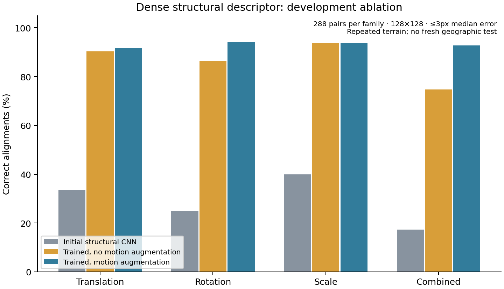

# Research iteration 4: learning local terrain structure

This iteration tests an original compact dense descriptor network and a controlled motion-training ablation. Both geographic reserves remain untouched. A descriptor-loss improvement is not evidence of a registration improvement; the full common development outcomes and their audits are required below before drawing that conclusion.

## Why this hypothesis

The previous image-only structural selector improves over older LoFTR, but running stronger learned variants substantially narrow that advantage. More candidate models alone have not established a substantial improvement over current methods. This iteration instead learns the local representation from physical lighting pairs.

[CoMIR](https://arxiv.org/abs/2006.06325) motivates contrastive common representations for multimodal registration; [D2-Net](https://openaccess.thecvf.com/content_CVPR_2019/papers/Dusmanu_D2-Net_A_Trainable_CNN_for_Joint_Description_and_Detection_of_CVPR_2019_paper.pdf) motivates dense learned descriptors under difficult appearance changes. The earlier medical-registration-inspired self-similarity experiment supplies a useful structural prior. This implementation is original, not a reproduction of CoMIR, D2-Net or full MIND.

One shared 28,272-parameter CNN maps twelve local self-difference channels and one locally normalized contrast channel into 32-dimensional unit descriptors. It has a finite radius of twelve native pixels; it receives no positional channels, known motion, terrain identity or ground-truth error. Full-neighborhood mask erosion excludes descriptors influenced by missing pixels. No image-wide normalization can transmit invalid pixels into distant descriptors.

## Controlled training and checkpoint selection

The frozen research manifest supplies 384 training and 64 development patches, all nine physical Sun renders. A split allowlist is applied before image loading; reserves cannot reach this training loader. There are 12,344 eligible unordered training light pairs, requiring at least 32 jointly valid, non-dark pixels. This eligibility criterion differs from the earlier DISK projection's sparse-grid criterion. Non-dark support is a training proxy, not verified geometric shadow visibility.

Each training step uses a random 80px crop and paired exact corresponding locations. The motion-augmented run applies continuous rotations in ±45°, scale .7–1.4, and translation ±12px. The ablation changes only training motion augmentation; it keeps the same initialization, training-pair set, 1,200 optimizer steps and fixed *motion-augmented* development bank. Both use symmetric within-pair contrastive loss, temperature .1, AdamW learning rate .0005, and fixed random seeds.

The fixed validation bank has 58 eligible development crops. Initial weights remain eligible for selection; only the minimum development descriptor loss selects a checkpoint. Augmented training selects step 1,000, loss **3.42688→1.25073**; training without motion augmentation selects step 400, **3.42688→2.35086**. The two independent training audits reconstruct all 4,032 native images and 4,032 masks per run, all pair identities and the identical validation bank; they verify seeded initialization, checkpoint hashes, checkpoint selection and the selected checkpoint's actual descriptor loss. They do not replay every optimizer update.

## Development registration experiment

The same 1,224 cases used by the stronger-baseline experiment are required: eight predetermined patches × 36 Sun pairs × four motion families, plus 72 disjoint-terrain negatives. Native pixels, masks, exact transformations and ≤3px success threshold are unchanged. Initial and selected weights are both executed independently in both directions; all failed fits stay in the denominator.

Inference samples descriptors on a fixed four-pixel grid, requires mutual nearest neighbours with cosine similarity ≥.5, retains at most 512 matches, and uses the unchanged common partial-affine RANSAC. It never receives the case transformation or success labels. This is a documented original inference profile, not a published model's default. Both checkpoints pass actual known-translation and blank/invalid controls before lunar evaluation; the control's zero pixel error is procedural software evidence only.

Both runs completed and passed exhaustive native-input/analytic-geometry audits: **4,896 outcomes**, retaining every initial/selected failure and negative. The report generator verified identical initial-checkpoint predictions across both executions and exact native input equality with every listed baseline.

| Method | Translation /288 | Rotation /288 | Scale /288 | Combined /288 | Correct /1,152 | Non-overlap fits /72 |
|---|---:|---:|---:|---:|---:|---:|
| Initial structural CNN | 97 | 72 | 115 | 50 | 334 (28.99%) | 6 |
| Trained without motion augmentation | 260 | 249 | 270 | 215 | 994 (86.28%) | 70 |
| Trained with motion augmentation | 264 | **271** | **270** | **267** | **1,072 (93.06%)** | **69** |
| Earlier image-selected hybrid | **271** | 240 | 253 | 211 | 975 (84.64%) | 40 |
| Pretrained LoFTR | 181 | 178 | 180 | 165 | 704 (61.11%) | 0 |



The controlled motion-training difference is **78 additional correct pairs (+6.77 percentage points)**; 52 of those come from combined changes. This supports the development hypothesis that training across geometry matters. Relative to the earlier hybrid, the new descriptor adds 97 correct positives (+8.42 points), but translation success is seven cases lower. Neither result establishes generalization to unseen terrain or superiority over the stronger models still running.

The main failure is rejection: the selected descriptor returns a fit on all 1,152 positives, including 80 incorrect fits, and on 69/72 known non-overlap negatives. Its raw 93.06% success is not reliability.

Standalone image-evidence analysis completed on the unchanged transforms. Every one of its 2,448 rows passed native geometry verification and independent post-serialization image-evidence replay, including reverse evidence. Other-predictor agreement is unavailable in this standalone study and explicitly fixed at zero. Recomputing the entire 14,400-rule-per-method grid reproduces all selected confidence policies and their counts.

| Development confidence setting | Correct retained /1,152 | Wrong accepted | Non-overlap accepted /72 |
|---|---:|---:|---:|
| Trained CNN, zero observed-error budget | 549 (47.66%) | 0 | 0 |
| Trained CNN, ≤1% accepted-error budget | **981 (85.16%)** | **3** | **0** |
| Earlier hybrid + structural fallback, zero budget | 857 (74.39%) | 0 | 0 |
| Earlier hybrid + structural fallback, ≤1% budget | 916 (79.51%) | 4 | 0 |

At the permissive setting, this standalone descriptor retains 65 more correct fits and one fewer wrong fit than the earlier cascade. At the zero-error setting it retains 308 fewer correct fits. This is a tradeoff, not uniform dominance. The earlier cascade has an extra conditional decision stage, and this standalone CNN has no cross-predictor agreement evidence. All policies are selected on development data; the three wrong among 984 accepted alignments (0.305%) and zero accepted negatives are empirical observations, not held-out error guarantees.

A separate frozen fourteen-predictor experiment compares strong 4/expanded 12 pools with and without trained CNN predictions, plus separate initial/trained-only controls. Every pool uses the same radius 7 image evidence and global score. Untrained CNN weights cannot influence any trained/modern pool. Complete-source bindings, image-choice replay and the existing common confidence grid must finish before interpreting that comparison. [Evidence replay](contrastive_terrain_evidence_audit.json), [confidence grid audit](contrastive_terrain_confidence_audit.json), [selected candidate policies](contrastive_terrain_quality_gates.json).

The trained CPU forward median is approximately 110ms in this execution, using two Torch threads and concurrent local workloads. This is descriptive only: older methods used different thread/device conditions, and cached-prediction hybrid selection excludes upstream inference. No fair speed advantage is claimed.

Evidence: [machine-readable summary](contrastive_terrain_development.json), [augmented input/geometry audit](contrastive_terrain_dev_audit.json), [no-motion input/geometry audit](contrastive_terrain_nomotion_dev_audit.json), [augmented training audit](contrastive_terrain_training_audit.json), [no-motion training audit](contrastive_terrain_nomotion_training_audit.json).

## Reproducible measurements

The [completed-measurement capsule](contrastive_terrain_v1.zip) and [checksum](contrastive_terrain_v1.sha256) retain both training runs' small original checkpoints, configs, manifests, pair identities and source-array hashes, both full matching experiments, and the standalone image-evidence/confidence experiment. Each archived member was checked byte-for-byte. Third-party pretrained weights, original source rasters and the derived training image cache are excluded. The [exact source snapshot](development_source_snapshot_v4.json), [software validation](research_validation_v4.json) and [frozen stronger-model/CNN design](terrain_blend_design_v1.json) preserve implementation and active-plan provenance.

Acquire the checksummed physical renders with the repository tools first. Extract the capsule into `runs/`. The optional cache-rebuild flag reconstructs only train/dev inputs without fitting; the resulting cache hash was actually reproduced from source bytes. Use a fresh audit output path:

```sh
python -m zipfile -e reports/contrastive_terrain_v1.zip runs
python verify_contrastive_training.py runs/contrastive-terrain-train-v1 --rebuild-cache --output runs/contrastive-training-recheck.json
python verify_contrastive_training.py runs/contrastive-terrain-nomotion-train-v1 --rebuild-cache --output runs/contrastive-nomotion-training-recheck.json
python verify_research_dev.py runs/contrastive-terrain-dev-v1 --output runs/contrastive-dev-recheck.json
python verify_research_dev.py runs/contrastive-terrain-nomotion-dev-v1 --output runs/contrastive-nomotion-dev-recheck.json
```

If the image cache already exists, omit `--rebuild-cache`. The separate [RoMa software-proof capsule](roma_pretrained_probe_v1.zip), [checksum](roma_pretrained_probe_v1.sha256) and [GitHub origin](roma_pretrained_probe_origin.json) contain the three executed control artifacts, not model weights. Its original downloaded GitHub ZIP hash and the repacked capsule's hash are distinguished explicitly.

## Dense baseline validation and execution

Original pretrained RoMa passed its separate Linux CPU proof in [run 40979289914](https://github.com/ThomasdeChillaz/lunar-image-matching/actions/runs/40979289914): **.04926px median endpoint error**, 4,955 supporting matches, explicit low-texture and invalid-mask failures. The downloaded three-file artifact's GitHub ZIP hash was verified, and [the local independent audit](roma_pretrained_probe_audit.json) reconstructs exact native pixels and geometric error. This is a software control, not a lunar accuracy result.

The complete declared model profile takes **79.27 seconds per CPU forward** on that runner. The full [run 40980043474](https://github.com/ThomasdeChillaz/lunar-image-matching/actions/runs/40980043474) retains author resolution/arithmetic, all 1,224 inputs and two independently estimated directions. It uses 32 blind shards (at most 39 cases each), with eight jobs at a time; the preceding eight-shard design would exceed the job time limit at the observed speed. Only scheduling changes. A fresh proof in the same workflow execution must pass before those prediction shards start. No scored dense lunar outcome exists yet.

## Validation and claim boundary

Current local software validation: **108 tests passed**, including actual existing pretrained-model inference and new descriptor-coordinate, finite-support, gradient, crop, split and pool-exclusion controls; a fresh procedural smoke produced 20 summaries. An actual cache rebuild from acquired rasters reproduces its frozen hash without retraining. Training audits and software controls do not establish a geographic improvement. The active full EfficientLoFTR, MatchAnything, controlled-pool, dense and confidence experiments preserve their frozen sources and complete failures/negative cases.

The development terrain still has only two overlapping-footprint/acquisition components, despite many lighting/motion combinations. Both reserves remain unused. All sampled regions are within Tycho; the 128px similarity-warp experiment does not test full spacecraft perspective, relief or navigation in metres. Current-SOTA superiority, fresh geographic generalization and real-image navigation accuracy remain unverified. No human annotation is requested or awaited.
