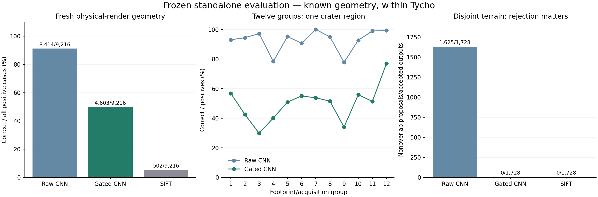

# Research iteration 5: frozen evaluation and real-sensor checks

The standalone CNN and strict rejection rule were frozen before reserve access. The original 13-predictor ensemble remains a development result; this report does not claim its fresh-test validation or current state-of-the-art superiority.

## What changed

1. The primary experiment uses all 64 reserve patches in 12 footprint/acquisition groups, rather than treating 1,152 repeated development pairs as independent terrain tests. The geography remains within Tycho.
2. The fixed checkpoint, source/model hashes, threshold, case plan and evaluation targets were published before opening reserves. No reserve fitting or checkpoint selection occurred.
3. Rejection is enforced in public outputs. Raw transforms remain research proposals and are never returned as accepted alignments when the gate rejects.
4. Real orbital photo controls and independently laser-referenced laboratory diagnostics were executed. Real orbital navigation accuracy remains unverified; neither warped photos nor nominal calibration agreement can establish it.

## Public preregistration

[Preregistered commit](https://github.com/ThomasdeChillaz/lunar-image-matching/commit/b7f2e0fe24be08dac5c0e1201e9451b6a625d59f), published 30 October 2026 at 08:24:27 UTC. The full 9,216-positive/1,728-negative plan covers all 36 Sun pairs and four geometry families per reserve patch. Negatives use three separately grouped, buffered-disjoint partners and nine lights.

Protocol SHA256: `6394d81f9714f4ef18a0eae61df761ef4b38d9c0d03e680399a1400cdbeeec20`. Model SHA256: `ab555480bf44c878f509ffacbe2778f35bbd48d1f1b4b04902fb6e858d9ca416`. Both reserves are now consumed and must not be reused as fresh data.

## Untouched-terrain results

| Fixed method | Correct /9,216 positives | Wrong positive fits | Rejected/failed positives | Accepted nonoverlap /1,728 |
|---|---:|---:|---:|---:|
| CNN raw proposal | 8,414 (91.30%) | 306 | 496 | 1,625 |
| CNN with frozen rejection | 4,603 (49.95%) | 0 | 4,613 | 0 |
| SIFT | 502 (5.45%) | 0 | 8,714 | 0 |

The gated positive success rate has an exploratory component-bootstrap 95% interval of 45.12–53.77%. Resampling joins shared acquisitions and overlapping footprints; disconnected components can still be correlated within one crater. Negative pairs reuse both component endpoints, so no independent-pair confidence guarantee is inferred.

**Predeclared empirical targets met: True.** Targets: at least 40% of all positives correctly accepted, accepted-error fraction≤1%, nonoverlap acceptance≤1%, at least 12 components. These are empirical evaluation targets, not statistical deployment guarantees. Failed targets are preserved; no threshold is revised here.



## Separate geometric families

| Family | Raw CNN correct /2,304 | Gated CNN correct /2,304 | Gated wrong positive fits |
|---|---:|---:|---:|
| translation | 2,105 | 829 | 0 |
| rotation | 2,108 | 1,293 | 0 |
| scale | 2,109 | 1,227 | 0 |
| combined | 2,092 | 1,254 | 0 |

## Real orbital pixels: exact controls and unknown repeat accuracy

The unchanged Tycho-trained model was evaluated on 42 acquisitions across Chang’e 3, Apollo 11 and near Shackleton. These are three previously inspected source scenes, not42 independent new terrains. Two known warps per geometry family provide 336 exact controls;84 pairs come from different scenes. No real-data training or threshold calibration occurs.

| Method | Correct known-warps /336 | Different-scene accepted /84 |
|---|---:|---:|
| CNN raw proposal | 336 | 83 |
| CNN with frozen rejection | 334 | 0 |
| SIFT | 303 | 0 |

The 321 genuine repeat-observation pairs remain unverified diagnostics. The gate accepts 13/45 S1,19/45 S2 and 45/231 S3 pairs; these are acceptance counts, not verified-correct counts. Published map coordinates have unknown reference uncertainty.

## Real sensors and physical relighting: an important failure

Four NASA Ames POLAR laboratory terrains provide 24 pairs: eight same-camera relighting cases and 16 stereo cases with published laser XYZ and camera calibration. Original member CRC32, SHA256 and the nominal projection/scoring replay passed. The model never receives laser coordinates.

Raw CNN nominally aligns 4/8 same-camera relighting pairs within 3 px; the strict gate retains 0/8. This exposes poor transfer of the rejection rule to real changing-light sensor data. The successful orbital-photo warps do not resolve it.

Returned inlier matches are scored against external laser projections, with a0.35 px nearest-reference tolerance and explicit visibility filtering. These are nominal correspondence-reference diagnostics, not global registration success or a reproduced dense-stereo benchmark.

Across all 24 mixed cases, raw CNN has 116/186 laser-scorable returned inlier matches within 3 px; gated CNN22/27; SIFT42/42. Different returned coverage prevents interpreting these ratios as a method ranking. Full outcomes, missing-reference counts and failures remain in the capsule.

NASA reports sub 2 mm laser accuracy, but calibration covariance and cross-light rig drift are not supplied as pixel-accuracy bounds. The reference projection is external; its complete uncertainty is unknown. These are laboratory analogues, not photographs acquired on the Moon. [NASA dataset](https://ti.arc.nasa.gov/dataset/IRG_PolarDB/), [documentation](https://ti.arc.nasa.gov/dataset/IRG_PolarDB/PolarDB_Readme.pdf).

## What remains unresolved

- Cross-crater/polar transfer under genuine changing sunlight is not established by the within-Tycho reserves or by single-photo warps.
- The 13-predictor ensemble’s95.75% remains development-only. Its frozen development export retains 1,069 outputs and returns null for rejected proposals; that is not held-out reliability evidence.
- Real orbital navigation accuracy requires independent reference geometry with characterized uncertainty. No automatic matcher agreement, laser instrument accuracy alone, or unknown-uncertainty map coordinate is promoted to that claim.
- A subsequent model/gate change must use development data and a new untouched evaluation. Both original reserves are consumed. The NASA relighting failure is a new development lead, not a result to conceal by refitting this report.

## Reproduce

Use the locked research environment and existing source archives/training capsule. From the repository, after restoring the completed-measurement capsule:

```sh
python verify_reserve.py runs/reserve-frozen-v1 --output runs/reserve-audit-replay.json
python verify_real_sensor.py runs/real-sensor-controls-v1 --output runs/real-sensor-audit-replay.json
python fetch_polar_reference.py
python verify_polar_reference.py runs/polar-reference-v1 --output runs/polar-audit-replay.json
```

Fresh execution uses the committed protocols and new output directories. Do not rerun a freeze command over a published protocol. Source and checkpoint mismatches are errors.

```sh
python reserve_evaluation.py run --freeze reports/reserve_protocol_v1.json --output runs/reserve-reproduction
python real_sensor_controls.py run --protocol reports/real_sensor_protocol_v1.json --output runs/real-sensor-reproduction
python polar_reference.py run --protocol reports/polar_reference_protocol_v1.json --output runs/polar-reference-reproduction
```

Validation: research suite 112 passed/4 skipped; minimal core 107 passed/5 skipped; fresh 20-summary procedural smoke. The selected CNN ran actual software, CLI and real-data experiments; optional unexecuted matcher tests are not counted as pretrained validation.

[Execution environment](validation_environment_v1.json), [ensemble development capsule](ensemble_development_v1.zip), and [public ensemble export audit](ensemble_public_export_audit.json) supplement the complete standalone-validation capsule. The ensemble capsule preserves original development outputs; it is not a fresh-test result.
