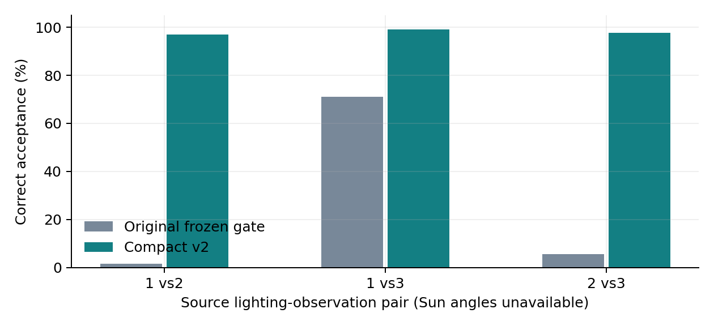
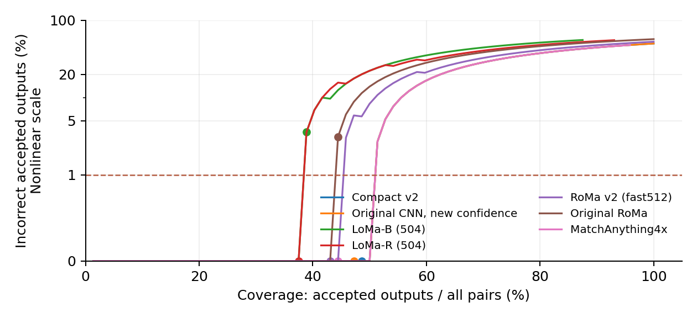
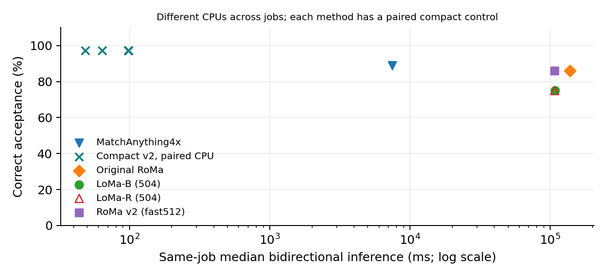
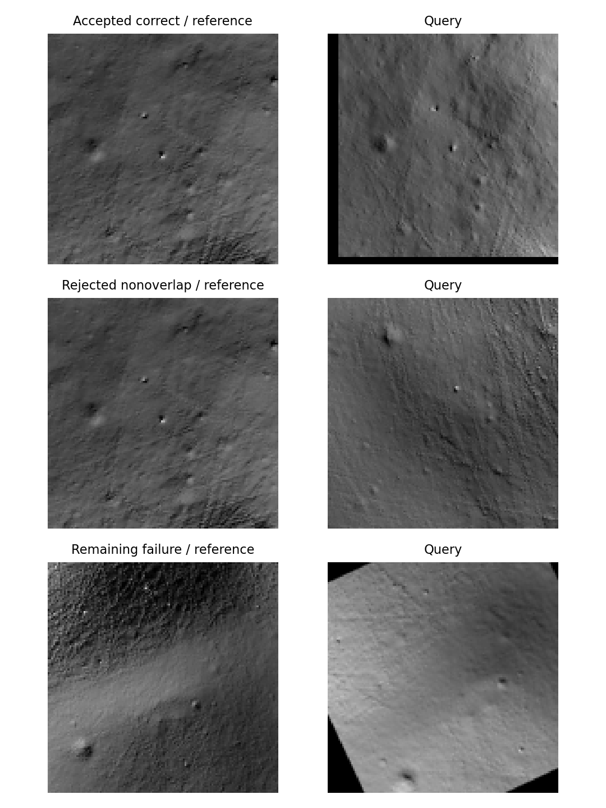

# Compact lunar matching: frozen south-pole study

**Question:** Can a compact illumination-aware matcher retain more correct alignments while rejecting incorrect outputs?

Selected configuration: **expanded**; primary seed 20261030, with both other predefined seeds reported.

Inference uses 128px derived images. A correct render alignment has median error at most 3 input pixels, equivalent to 12 original 512px source pixels. This is a coarse-registration criterion.

## Full frozen render evaluation

| Method | Correctly accepted positives | Incorrect accepted outputs | Accepted nonoverlap |
|---|---:|---:|---:|
| Original CNN, frozen gate | 100/384 (26.04%) | 0 | 0/288 |
| Original CNN, new confidence | 368/384 (95.83%) | 0 | 0/288 |
| Compact v2, seed 20261030 | 376/384 (97.92%) | 0 | 0/288 |
| Compact v2, seed 20261031 | 351/384 (91.41%) | 0 | 0/288 |
| Compact v2, seed 20261032 | 380/384 (98.96%) | 1 | 1/288 |
| SIFT | 0/384 (0.00%) | 0 | 0/288 |

Raw primary success: 384/384. Frozen confidence retains 376 correct alignments and accepts 0 incorrect outputs, including 0/288 nonoverlap pairs.

Primary-minus-original-frozen gain: **+71.88 percentage points**; exploratory spatial-component bootstrap 95% interval **+68.63 to +75.00**. Twelve components share a terrain model/rendering pipeline; they are not guaranteed independent.

Predeclared 10-point improvement/error-budget target met: **True**. Positive grouped evidence: **True**.

## Identical common-input comparison

All rows use the same 36 positive and 36 nonoverlap cases. Method-specific internal resolution and lunar training differ; this is not a reproduction of any paper benchmark.

| Method | Raw positive success | Correct acceptance | Incorrect accepted outputs | Nonoverlap accepted |
|---|---:|---:|---:|---:|
| Compact v2 | 36/36 | 35/36 | 0 | 0/36 |
| Original CNN, new confidence | 36/36 | 34/36 | 0 | 0/36 |
| SIFT | 0/36 | 0/36 | 0 | 0/36 |
| LoMa-B (504) | 28/36 | 27/36 | 1 | 0/36 |
| LoMa-R (504) | 30/36 | 27/36 | 0 | 0/36 |
| RoMa v2 (fast512) | 34/36 | 31/36 | 0 | 0/36 |
| Original RoMa | 31/36 | 31/36 | 1 | 0/36 |
| MatchAnything4x | 36/36 | 32/36 | 0 | 0/36 |

| CPU method | Median bidirectional latency (ms) | Paired compact latency (ms) | Median paired speedup | Peak process MiB range |
|---|---:|---:|---:|---:|
| MatchAnything4x | 7452.2 | 64.0 | 101.2x | 1469--1538 |
| Original RoMa | 137661.5 | 48.2 | 2443.9x | 6271--6408 |
| LoMa-B (504) | 107802.4 | 97.9 | 1097.6x | 2835--2837 |
| LoMa-R (504) | 107388.1 | 98.4 | 1094.1x | 2834--2837 |
| RoMa v2 (fast512) | 107135.5 | 97.8 | 1098.3x | 3039--3088 |

Memory is process high-water RSS including loading and warmup, not weight size. Each speedup uses the baseline and compact model on identical cases in the same CPU job. The JSON also reports the compact model accuracy measured in those jobs.

Strongest completed modern baseline within the declared error constraints: **MatchAnything4x**. Compact-minus-baseline correct acceptance: **+8.33 points**, with exploratory grouped 95% interval **-2.78 to +19.44**. Competitive point target met: **True**; exploratory uncertainty support: **True**. A point target alone does not establish superiority.

## Development ablations

One fixed seed per cumulative experiment; 96 positive development cases. These outcomes selected the configuration and are not final-test evidence.

| Configuration | Raw correct positives | Trainable parameters | Median source error among correct fits | Raw nonoverlap proposals |
|---|---:|---:|---:|---:|
| expanded | 93/96 | 28,272 | 2.57 px | 72/72 |
| reliability | 92/96 | 28,305 | 3.12 px | 72/72 |
| hard_negatives | 89/96 | 28,305 | 2.83 px | 72/72 |
| multiscale | 87/96 | 28,305 | 2.92 px | 72/72 |

## Descriptive final strata

Primary model only. Longitude sectors and image-brightness support are descriptive; shared terrain/rendering dependence remains.

| Stratum | Group | Correct accepted positives |
|---|---|---:|
| mode | nadir | 129/132 |
| mode | oblique | 105/108 |
| mode | dynamicgood | 142/144 |
| polar_longitude_sector | 0 | 150/156 |
| polar_longitude_sector | 2 | 83/84 |
| polar_longitude_sector | 1 | 143/144 |
| shared_brightness_proxy | high shared bright support (>=75%) | 362/368 |
| shared_brightness_proxy | medium shared bright support (25-75%) | 14/16 |
| component | polar-component-0002 | 59/60 |
| component | polar-component-0003 | 57/60 |
| component | polar-component-0004 | 12/12 |
| component | polar-component-0008 | 12/12 |
| component | polar-component-0010 | 22/24 |
| component | polar-component-0012 | 36/36 |
| component | polar-component-0013 | 71/72 |
| component | polar-component-0014 | 12/12 |
| component | polar-component-0020 | 36/36 |
| component | polar-component-0022 | 24/24 |
| component | polar-component-0024 | 24/24 |
| component | polar-component-0027 | 11/12 |

CPU speedups are computed only from paired same-job controls; missing controls do not support speedup claims.

## Three-dimensional matching

Raw correspondences are extracted before any planar fitting. Pose uses reference-map depth and predicted query pixels; query reference depth participates only in correspondence scoring, never in pose estimation. The secondary simulated pose threshold is 2 degrees and 1% of reference ray range.

- Compact v2: 2/288 poses meet the secondary criterion; 142/288 poses estimated. Match coverage: 34387/60695 reference-scorable raw matches within 3 benchmark pixels (12 original render pixels), out of 92246 returned matches. These different correspondence coverages are not a method ranking.
- Original CNN, new confidence: 2/288 poses meet the secondary criterion; 140/288 poses estimated. Match coverage: 30188/55966 reference-scorable raw matches within 3 benchmark pixels (12 original render pixels), out of 85949 returned matches. These different correspondence coverages are not a method ranking.
- SIFT: 7/288 poses meet the secondary criterion; 60/288 poses estimated. Match coverage: 727/785 reference-scorable raw matches within 3 benchmark pixels (12 original render pixels), out of 1177 returned matches. These different correspondence coverages are not a method ranking.

## Sensor transfer and failures

NASA POLAR uses new lighting configurations of previously inspected laboratory terrains. Nominal fixed-camera agreement has unknown drift/calibration uncertainty. It is not verified lunar navigation accuracy.

- Compact v2: 23/40 accepted within nominal 3 benchmark pixels (28.5 sensor pixels); 1 accepted outside the nominal criterion.
- Original CNN, new confidence: 22/40 accepted within nominal 3 benchmark pixels (28.5 sensor pixels); 0 accepted outside the nominal criterion.
- SIFT: 0/40 accepted within nominal 3 benchmark pixels (28.5 sensor pixels); 0 accepted outside the nominal criterion.
- Original frozen rejection rule on these same new configurations: 8/40 nominally correct acceptances; 0 outside criterion.

## Limits

- Physical renders, not acquired lunar navigation ground truth.
- Earlier real orbital repeat-image diagnostics remain in iteration5. Their correctness is unverified; they were not used to fit this candidate or confidence.
- Explicit trajectory identifiers are absent. Splits group selected footprints/shared poses; trajectory-held-out independence is unverified. This shortfall was documented after training and before final inference.
- Inference 128px; render tolerance 3 benchmark pixels =12 original512px source pixels. POLAR nominal tolerance =28.5 original sensor pixels.
- Training uses 18 polar geometries/54 lighting images; geographic expansion is not a claim of a larger image count.
- The winner retains the original architecture. Comparison with the old checkpoint combines a new training regime and confidence calibration; it is not an isolated causal estimate of additional data or a novel-architecture claim.
- Shared-brightness strata are descriptive image-support proxies, not physical illumination angles or causal effects.
- Common modern comparison has 36 positives and 36 negatives across 12 spatial components.
- Confidence calibration has only 12 positives and 12 negatives across 4 components; no 1 percent risk guarantee.
- Negative pairs reuse both component endpoints. Shared terrain model and renderer create further dependence.
- Sun-angle metadata absent; lighting-observation IDs cannot be interpreted as fixed angular changes.
- Modern CPU profiles retain author BF16 settings and require native BF16 to fit the free-compute budget. Speed is profile-specific, measured only against paired controls; no CPU-optimized precision alternative was substituted.
- Free runner CPU models and architectures vary. Compare each baseline with its own same-job compact control; absolute latencies across different baseline allocations are not a controlled hardware ranking.
- RoMa v2 precise author-profile control exceeded its 600-second free-CPU budget (exit124). The completed common comparison uses the explicitly declared fast512 profile; no precise-profile lunar result is inferred.
- Risk-coverage curves are descriptive test curves; operating points were fixed on calibration data. Coverage includes every positive and negative pair; risk is undefined when no output is accepted.

No current-global-SOTA, NASA/JPL affiliation or flight-readiness claim is made. Earlier development and Tycho reserve results remain separate.

Sources: [MoonAnything](https://zenodo.org/records/18415119), [LoMa](https://www.davnords.com/loma), [RoMa v2](https://arxiv.org/abs/2511.15706), [NASA POLAR](https://ti.arc.nasa.gov/dataset/IRG_PolarDB/).
